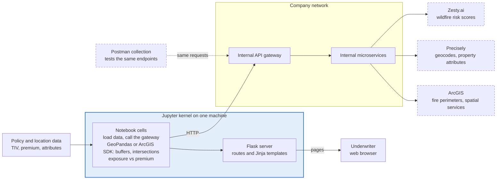
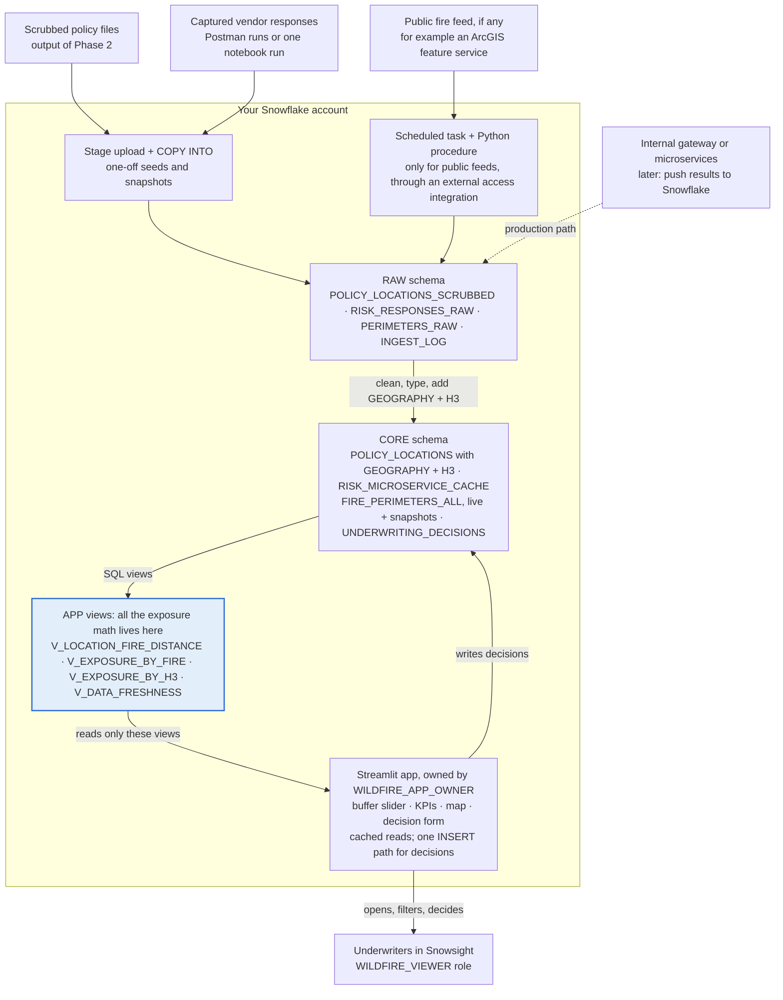
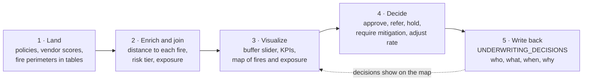
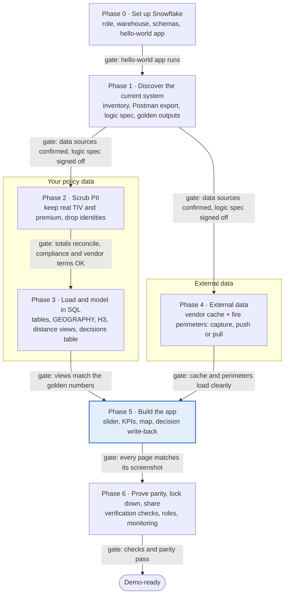
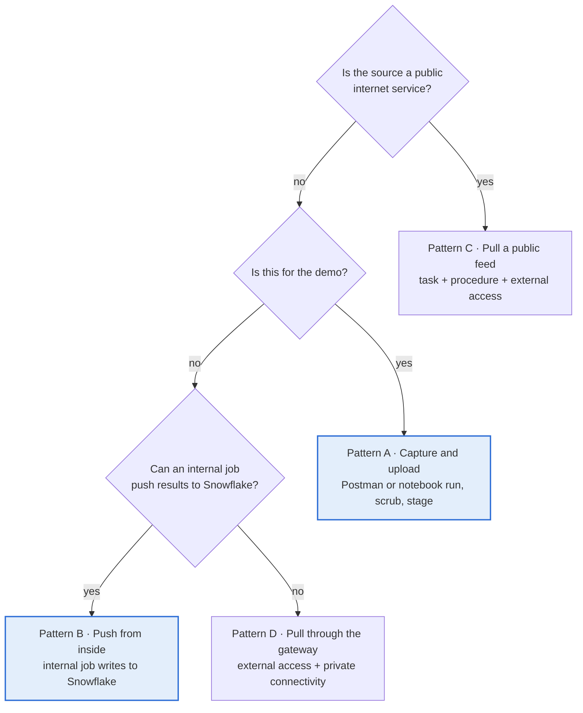

# Wildfire Underwriting App: Flask/Jupyter to Streamlit in Snowflake Runbook (v2)

*Version 2 · Oct 14, 2026 · Jim Ball · [What changed since v1](CHANGELOG.md) · [v1 for comparison](../wildfire-sis-runbook/README.md)*

> **Status: draft.** v2 folds in a second analysis of this system that names the likely data sources (Zesty.ai, Precisely and ArcGIS, reached through an internal API gateway) and an existing Postman test suite. Those details are **working hypotheses, not confirmed facts**. The table below separates what's known from what's suspected; Phase 1 settles each row.

## How to use this runbook

You will rebuild the wildfire exposure tool as a Streamlit app that lives inside Snowflake, where underwriters see exposure against premium and record their decisions. There are two ways through: a **demo fast path** of about a week that gets a convincing, real-numbers demo in front of the customer, and the **full migration** in seven phases, each ending with a check you can tick off. You don't need to know Snowflake well to start: Phase 0 walks through every click.

**Who this is for:** someone comfortable with Python, pandas and Flask, new to Snowflake and Streamlit in Snowflake (SiS).

### What we know, what we suspect, what Phase 1 must confirm

None of this has been checked against the code yet. "Likely" items come from the second analysis; treat them as the first thing to verify, not as design inputs.

| Topic | Status | Current understanding | How Phase 1 settles it |
| --- | --- | --- | --- |
| App shape | Known | Jupyter notebook that starts a Flask app; HTML/Jinja pages for underwriters | P-1 inventory |
| Purpose | Known | Compare an area's wildfire exposure with the premium written there | Underwriter review (1.4) |
| Policy data | Known | Policies and locations with TIV and premium, exportable from the running system | P-2 profile |
| Data access path | Likely | Notebook calls **internal microservices through an API gateway**, not vendors directly | P-1 data sources; Postman collection |
| Property risk scores | Likely | **Zesty.ai** wildfire risk scores per property | Postman responses; P-1 |
| Geocoding and attributes | Likely | **Precisely** latitude/longitude and property attributes | Postman responses; P-1 |
| Fire perimeters / spatial | Likely | **ArcGIS** feature services or SDK (possibly the public NIFC/WFIGS services, which are hosted on ArcGIS) | P-1 host list |
| Spatial math | Likely | pandas/GeoPandas or ArcGIS SDK buffers and intersections in memory | P-3 logic spec |
| Test harness | Likely | A **Postman collection** that exercises the microservices | Ask the team; export it |
| Decisions | Unknown | Whether underwriter decisions are saved today (CSV export, POST endpoint, nowhere) | P-1 entry points |
| NASA FIRMS hotspots | Corrected | v1 assumed FIRMS and NIFC directly; you've said that's wrong. FIRMS stays in Phase 4 only as a worked example of a public feed | P-1 host list |

### How to work through it

1. Pick a path below. If a customer demo is the near-term goal, take the fast path first; everything it builds is reused by the full migration.
2. Read the diagrams in the next sections; they show where every piece of today's app ends up.
3. Don't skip Phase 0, even if it feels basic; most first-time SiS problems are role and privilege problems.
4. When a phase says "run prompt P-n", copy that prompt from the [Prompt library](PROMPT_LIBRARY.md) into Claude Opus (or a model of similar strength) in a session where the files it lists are attached. The prompts are written to be run where the code lives.
5. Never paste raw policyholder data into an AI tool your company hasn't approved for PII, and remember a notebook saved with outputs **contains data rows**. Section 1.1 shows how to give the AI code without data.
6. Keep a running "decisions log" (a simple list of what you chose and why). The parity test in Phase 6 depends on it.

### Two paths: demo fast path or full migration

The fast path trades completeness for speed: it uses captured vendor responses instead of live calls, a single-file app, and a frozen fire snapshot. It still uses the real scrubbed portfolio, so the numbers are ones the customer will recognise.

| Step | Demo fast path (about 5 to 7 working days) | Full migration (about 15 to 23 working days) |
| --- | --- | --- |
| Setup | Phase 0 as written | Phase 0 as written |
| Discovery | P-1 and P-3 only, plus a Postman export and one golden date | All of Phase 1 |
| Data | Scrub the full book (Phase 2), load once (Phase 3.1 to 3.3) | All of Phases 2 and 3 |
| External data | Seed `RISK_MICROSERVICE_CACHE` and one fire snapshot from captures (Pattern A in Phase 4) | Choose a pattern per source; schedule refreshes |
| App | One `streamlit_app.py` from **P-12**: buffer slider, four KPIs, map, decision form | One page per Flask route with **P-8** |
| Proof | Section 6.6 verification checks plus one golden-date comparison | Full parity harness (P-9), roles, monitoring |
| Leaves for later | Live refresh, multi-page port, monitoring, Git-driven deploys | Nothing |

These effort figures are rough planning estimates, not measurements. The fast path is a deliberate shortcut: say "demo build" whenever you show it, and don't let it become production by accident.

## Where everything goes

Every job the notebook kernel does today moves to its own Snowflake object, and the app shrinks to something that only reads views.

*Today (likely): the notebook calls internal microservices through an API gateway, does the spatial math in memory, and Flask serves the pages. Dashed boxes are unconfirmed.*



Today the kernel is the whole system: it calls the gateway, holds the results in memory, does the math and serves the pages. Every page view can mean another round of gateway calls, some of them to paid vendors.

*Target: external data lands in Snowflake tables first, the math runs in SQL views, and the app reads views and writes decisions. Everything inside the box runs in your Snowflake account, under Snowflake roles.*



In Snowflake each job gets its own home: captured or pushed data lands in RAW, SQL views hold the exposure math, and the app reads views and writes one thing back, the underwriter's decision. Snowflake never has to reach into your company network for the demo.

### The underwriter's loop

The app exists to support one loop, which the design follows end to end:



Step 5 is new in v2: underwriters record a decision in the app instead of exporting a CSV, and the decision table becomes an audit trail.

### Translation table

| In your current setup | In Streamlit in Snowflake | Phase |
| --- | --- | --- |
| `flask run` started from a notebook cell | An always-on app object, opened from **Projects** » **Streamlit** | 0 |
| `pip install` in the kernel | `pyproject.toml` (container runtime) or `environment.yml` (warehouse runtime) | 0, 5 |
| A cell that reads a CSV or Excel file | A stage upload plus `COPY INTO` a RAW table | 3 |
| pandas exposure-vs-premium math | SQL views in the APP schema; Python only where SQL can't do it | 3 |
| GeoPandas or ArcGIS SDK buffers and intersections | `ST_DWITHIN`, `ST_DISTANCE`, `ST_INTERSECTS` on GEOGRAPHY columns | 3 |
| Call to the internal API gateway (Zesty, Precisely) | A cache table (`RISK_MICROSERVICE_CACHE`) seeded from captured responses; later fed by the microservices | 3, 4 |
| `requests.get()` to a public feed | A Python stored procedure with an external access integration, run by a task | 4 |
| Postman collection | The source of truth for endpoint fields, and a way to capture seed responses | 1, 4 |
| CSV export or POST endpoint for decisions | An `st.form` that inserts into `UNDERWRITING_DECISIONS` | 3, 5 |
| API key in `.env` or in code | A Snowflake SECRET object | 4 |
| APScheduler or a background thread | A Snowflake task | 4 |
| A DataFrame held in memory between requests | Snowflake tables, plus `conn.query(..., ttl=...)` caching | 5 |
| `@app.route("/map")` | A file in the `pages/` folder | 5 |
| `request.args` and form fields | `st.selectbox`, `st.slider`, `st.date_input`, grouped in `st.form` | 5 |
| Jinja template | Streamlit layout: `st.columns`, `st.tabs`, `st.metric`, `st.dataframe` | 5 |
| Folium or Leaflet map | `st.pydeck_chart` with scatter, GeoJSON and H3 hexagon layers | 5 |
| JSON endpoint other systems call | A Snowflake view those systems query; SiS apps don't serve APIs | 5 |
| Flask login | Snowflake roles and app sharing | 6 |

## The journey at a glance

Seven phases, each closed by a gate taken from its exit check; your policy data and the external data (vendor scores and fire perimeters) are separate tracks that meet when you build the app.

*Your data and the external data move in parallel, then meet in the app. Each labelled arrow is a gate: don't start the next phase until its check passes.*



Phase 4 doesn't depend on Phases 2 and 3, so if a colleague can take the external data, the two tracks run side by side. Every phase is on the fast path, but in a lighter form; the path table above says which parts. The rough effort figures in each phase add up to about 15 to 23 working days for one person.

## Phase 0: Set up Snowflake and ship a hello-world app

By the end of this phase you have your own role, warehouse and database, and a starter Streamlit app running in Snowflake, before any wildfire code moves. Rough effort: half a day, mostly waiting on your admin for grants.

### 0.1 Find out what you're working with

Open Snowsight (the Snowflake web UI), start a SQL worksheet and run:

```sql
SELECT CURRENT_ACCOUNT(), CURRENT_REGION(), CURRENT_ROLE(), CURRENT_WAREHOUSE();
SHOW GRANTS TO ROLE IDENTIFIER(CURRENT_ROLE());
```

Then ask your Snowflake admin three questions:

1. **Which edition are we on?** Sensitive data classification needs Enterprise Edition or higher, and so do masking policies. Standard Edition still works for everything else in this runbook. ([Snowflake docs](https://docs.snowflake.com/en/user-guide/classify-intro))
2. **Has the essential security setup for Streamlit been done?** Snowflake lists it as a prerequisite before anyone creates an app. ([Getting started](https://docs.snowflake.com/en/developer-guide/streamlit/getting-started/overview))
3. **Are we in a government region?** Container runtimes aren't supported there; you'd use the warehouse runtime instead. ([Runtime environments](https://docs.snowflake.com/en/developer-guide/streamlit/app-development/runtime-environments))

### 0.2 Have your admin run this setup script

Send this to your admin as-is. It creates a development role you own, a small warehouse that shuts itself off, and a database you control. Replace `<YOUR_USER>`.

```sql
USE ROLE ACCOUNTADMIN;

-- 1. A role for you
CREATE ROLE IF NOT EXISTS WILDFIRE_DEV;
GRANT ROLE WILDFIRE_DEV TO USER <YOUR_USER>;

-- 2. A small warehouse that suspends after 60 idle seconds
CREATE WAREHOUSE IF NOT EXISTS WILDFIRE_WH
  WAREHOUSE_SIZE = 'XSMALL'
  AUTO_SUSPEND = 60
  AUTO_RESUME = TRUE
  INITIALLY_SUSPENDED = TRUE;
GRANT USAGE ON WAREHOUSE WILDFIRE_WH TO ROLE WILDFIRE_DEV;

-- 3. A database your role owns
CREATE DATABASE IF NOT EXISTS WILDFIRE_DB;
GRANT OWNERSHIP ON DATABASE WILDFIRE_DB TO ROLE WILDFIRE_DEV;

-- 4. Container runtime: compute pool + Python packages from PyPI
GRANT USAGE ON COMPUTE POOL SYSTEM_COMPUTE_POOL_CPU TO ROLE WILDFIRE_DEV;  -- skip if your role can already use it
GRANT DATABASE ROLE SNOWFLAKE.PYPI_REPOSITORY_USER TO ROLE WILDFIRE_DEV;

-- 5. Needed later for the scheduled fire-data refresh (Phase 4)
GRANT EXECUTE TASK ON ACCOUNT TO ROLE WILDFIRE_DEV;
```

The compute pool and PyPI grants come straight from Snowflake's [dependency management](https://docs.snowflake.com/en/developer-guide/streamlit/app-development/dependency-management) and [privileges](https://docs.snowflake.com/en/developer-guide/streamlit/object-management/privileges) pages. Snowflake sets up a general-purpose compute pool in every account, so line 4's first grant is often unnecessary.

### 0.3 Create your schemas (you can do this yourself)

Once the admin is done, switch to your new role and build the three layers this runbook uses:

```sql
USE ROLE WILDFIRE_DEV;
USE WAREHOUSE WILDFIRE_WH;

CREATE SCHEMA IF NOT EXISTS WILDFIRE_DB.RAW;   -- data exactly as it arrives (fire feeds, uploads)
CREATE SCHEMA IF NOT EXISTS WILDFIRE_DB.CORE;  -- cleaned, scrubbed, typed tables
CREATE SCHEMA IF NOT EXISTS WILDFIRE_DB.APP;   -- views the Streamlit app reads, and the app itself
```

Think of RAW / CORE / APP as "inbox / filing cabinet / display case". The app only ever reads from APP.

### 0.4 Pick a runtime (container, unless something blocks it)

Streamlit in Snowflake runs your app in one of two ways. Container runtime is the better fit here, because underwriters share one live app and cached fire data is shared between them.

|  | Container runtime (recommended) | Warehouse runtime (fallback) |
| --- | --- | --- |
| How it runs | One shared, long-running app for all viewers | A fresh personal copy per viewer |
| Caching | Shared across all viewers | Only within one viewer's session |
| Python packages | Any PyPI package (via the artifact repository) | Only the Snowflake Anaconda channel |
| Python version | 3.11 | 3.9, 3.10 or 3.11 |
| Largest data sent to the browser | 200 MB default, configurable | 32 MB, fixed |
| Idle behavior | Suspends after three days with no viewers | Sleep timer you configure |
| Gotcha | Subject to compute-pool maintenance windows | Slower first load per viewer |

Source: [Runtime environments](https://docs.snowflake.com/en/developer-guide/streamlit/app-development/runtime-environments) and [Limitations](https://docs.snowflake.com/en/developer-guide/streamlit/limitations).

The second analysis assumed the warehouse runtime (an `environment.yml` and `get_active_session()`). Everything in this runbook works on either runtime; section 5.2 gives the dependency file for each, and the differences that matter are called out where they bite.

### 0.5 Ship the hello-world app

1. In Snowsight, select **Workspaces** in the left menu and open a workspace.
2. Select **+ Add new** » **Streamlit app**. Snowflake creates a folder with starter files and opens the editor.
3. Select **Run**. You should see the example app on the right.
4. Replace the contents of `streamlit_app.py` with the snippet below and select **Run** again.
5. Deploy it into `WILDFIRE_DB.APP` (follow Snowflake's [create and run in a workspace](https://docs.snowflake.com/developer-guide/streamlit/streamlit-in-workspaces/streamlit-in-workspaces-create-run) steps), choosing `WILDFIRE_WH` as the query warehouse.
6. Open it from **Projects** » **Streamlit** to confirm the deployed copy works.

```python
import streamlit as st

st.title("Wildfire exposure: hello world")

conn = st.connection("snowflake")
df = conn.query(
    "select current_user() as user_name, current_role() as role_name, current_warehouse() as wh"
)
st.dataframe(df)
st.success("If you can see your user and role above, Snowflake and Streamlit are talking.")
```

Prefer the command line? The [Snowflake CLI](https://docs.snowflake.com/en/developer-guide/streamlit/getting-started/overview) does the same with `snow init`, a `snowflake.yml` file and `snow streamlit deploy --open`. Stick with Workspaces until the app works; switch later if you want Git-driven deploys.

### Phase 0 exit check

- [ ] You can run `USE ROLE WILDFIRE_DEV;` and `USE WAREHOUSE WILDFIRE_WH;` without errors
- [ ] Schemas RAW, CORE and APP exist in WILDFIRE\_DB
- [ ] The hello-world app is deployed and shows your user and role
- [ ] You know your edition and which runtime you're using

## Phase 1: Discover what the current system really does

This phase turns the notebook and Flask code into three written documents (an inventory, a data profile and a logic spec) plus a set of "golden" numbers that the new app must reproduce. Rough effort: 2 to 3 days, most of it the AI-assisted analysis and one review with an underwriter.

### 1.1 Gather everything into one working folder

Do this on the machine (or approved environment) where the running system lives. Don't email any of it around.

| Put in the folder | How to get it | Why it matters |
| --- | --- | --- |
| The notebook as a **code-only script** | `jupyter nbconvert --to script your_notebook.ipynb` | Clean Python with no data rows or embedded images; safe and cheap to give an AI tool |
| The notebook **with outputs**, kept separate | `jupyter nbconvert --to markdown your_notebook.ipynb` (charts become separate image files) | Shows real shapes and values, but contains data: approved environment only |
| All Flask files | `app.py` (or similar), helper `.py` modules; `templates/` and `static/` too | Routes say what users can do; templates say what they see |
| **Postman collection and environment** | In Postman: collection » **Export** (v2.1 JSON); export the environment with secrets blanked | The fastest truthful map of every gateway endpoint, parameter and response field |
| Saved Postman responses | Run the collection with the Collection Runner and save responses for a handful of real locations | Real Zesty/Precisely/ArcGIS response shapes, and seed data for the vendor cache |
| Exact package list | In a notebook cell: `!pip freeze > requirements_current.txt` | Shows map, geo and data libraries you must replace or keep |
| Config with secrets removed | Copy `.env` or config files, then replace every key with `REDACTED` | Reveals gateway URLs, file paths, thresholds |
| Data samples from the running system | Export each input dataset (policies/locations, vendor responses, fire snapshots, rate tables) | The analysis runs on these |
| Screenshots of every page | One per Flask route, plus any filter states underwriters use | Your visual target for the Streamlit port |
| Golden outputs | For 2 or 3 dates, save the tables, totals and decisions the app showed (CSV + screenshot) | Phase 6 proves parity against these |

**Golden outputs are the most important thing on this list.** Pick dates when fires were active near insured locations, so the numbers are interesting and the test is meaningful.

**What to give the AI, and what not to.** A raw `.ipynb` is mostly JSON metadata and base64 images, so it burns context and, worse, carries whatever data rows were on screen. Give discovery prompts the code-only script, the Flask Python files and the Postman collection. Give templates only to the page-port prompt (P-8), one at a time, and screenshots instead of `static/`. Give outputs and responses only inside an environment approved for this data.

### 1.2 Run the three discovery prompts, in order

Each prompt is in the [Prompt library](PROMPT_LIBRARY.md). Start a fresh AI session for each one, paste the shared context block first, then the prompt, then attach the files it asks for.

1. **P-1 System inventory.** Produces `SYSTEM_INVENTORY.md`: every route, data source, gateway endpoint (cross-checked against the Postman collection), transformation, output, library and piece of hidden state, with file and cell references. It also fills in the "known / likely / unknown" table at the top of this runbook.
2. **P-2 Data profiling and decision drivers.** Produces `DATA_PROFILE.md`: each dataset's schema, row counts, keys, nulls, ranges and joins, plus a ranked list of the fields that actually drive the underwriting decision.
3. **P-3 Business logic spec and golden tests.** Produces `LOGIC_SPEC.md` (every formula, threshold and band in plain language and pseudocode) and `golden_tests/`, a set of input-to-expected-output cases.

### 1.3 What "important" means for this app

Point the prompts at these questions; they decide what survives the migration and what gets dropped:

- **Exposure definition:** Which value counts as exposure (TIV, building only, limit, PML)? Is it summed per location, per policy or per account?
- **Proximity rules:** Distance to a hotspot, to a perimeter edge, or inside a perimeter? Which distance bands (for example 1, 5, 10 miles), and are they hard-coded?
- **Premium comparison:** Is it premium per $1,000 of TIV, a ratio to modeled loss, or a threshold flag? Is premium annual or earned to date?
- **Fire data choices:** Where do perimeters come from (an ArcGIS service, a microservice, a file)? How fresh must they be? Are hotspots or buffers used as well as perimeters?
- **Vendor fields:** Which Zesty and Precisely fields does the math actually use (a score, a tier, a geocode, a match confidence)? Everything else in the response can be left in a raw JSON column.
- **Paid calls:** Which endpoints cost money per call? This decides how much you can capture for the demo and whether caching is required in production.
- **Distance as a filter or as bands:** Does the underwriter pick a radius, or read fixed bands? v2 supports both: a slider over a precomputed distance, with bands derived from it.
- **Decision output:** What does the underwriter do with the result: approve, refer, hold, require mitigation, adjust rate, or just watch? Is that decision recorded anywhere today?
- **Dead code:** Which notebook cells are experiments nobody uses? Leaving them out is the biggest time saver in Phase 5.

### 1.4 Review the logic spec with an underwriter (30 minutes)

Walk one underwriter through `LOGIC_SPEC.md` and the golden outputs. Ask three questions: "Is this how you read the screen?", "What do you look at first?" and "What's missing that you work out by hand?" Record their answers in your decisions log. The answers often reveal a filter or rule that lives in someone's head rather than in the code.

### Phase 1 exit check

- [ ] `SYSTEM_INVENTORY.md`, `DATA_PROFILE.md` and `LOGIC_SPEC.md` exist and you've read them end to end
- [ ] Golden outputs saved for at least 2 dates
- [ ] An underwriter has confirmed the logic spec, or you've noted their corrections
- [ ] Every "Likely" and "Unknown" row in the table at the top is now "Known" or explicitly parked
- [ ] You have a list of every endpoint and host the system calls, and which are internal (needed for Phase 4)
- [ ] The Postman collection is exported, and saved responses exist for at least the golden-date locations

## Phase 2: Scrub PII but keep the real exposure numbers

Remove or replace everything that identifies a policyholder, keep TIV, premium, limits and deductibles exact, and coarsen each location just enough that it can't be traced to a parcel while distance-to-fire results stay the same. Rough effort: 2 to 4 days including compliance review.

**Before you start:** confirm with your privacy or compliance team that this data may be used for the demo at all, and whether "the customer" seeing it changes anything. Scrubbed data from one carrier shown to a different company can still breach a data-use agreement, even with every name removed.

**Check the vendor terms too.** Zesty.ai scores and Precisely geocodes and attributes (if those are your vendors) come under licences that may limit storing their outputs in another platform, keeping them beyond a set period, or showing them to a third party such as the customer. Ask whoever owns those contracts three questions: may we store responses in Snowflake, for how long, and may we display scores to the demo audience? If the answer to the last one is no, show tiers or bands you derive yourself instead of the raw score. Precisely also publishes datasets on the Snowflake Marketplace, which may be a cleaner licensed route for production. ([Precisely on Snowflake Marketplace](https://www.precisely.com/press-release/precisely-launches-geo-addressing-and-data-enrichment-innovations-on-snowflake-marketplace))

### 2.1 Decide where the scrub happens

| Your Snowflake account is... | Do this | Why |
| --- | --- | --- |
| A demo or sandbox account | Scrub **before** loading, inside the environment where the running system lives; load only scrubbed files | Raw PII never enters the demo account |
| Your company's governed production account | Load raw into a locked-down RAW schema, scrub with SQL into CORE, protect RAW with masking policies | Keeps the scrub auditable and repeatable as data refreshes |

If you're not sure which you have, assume the first and scrub before loading.

### 2.2 Treatment for each kind of field

| Field group | Typical columns | Treatment | Real value kept? |
| --- | --- | --- | --- |
| Direct identifiers | Insured name, contact name, email, phone, FEIN/SSN | Drop the column, or replace with fake values (Python `Faker`, fixed seed) if a page displays a name | No |
| Record keys | Policy number, location ID, account ID, claim number | Replace with a salted hash token (HMAC-SHA256, secret salt kept outside the demo) so joins still work | No, but relationships kept |
| Street address | Street line, unit, full address string | Drop. Keep state and county; keep ZIP only at 3 digits if a page needs it | Partly |
| Coordinates | Latitude, longitude | Snap or jitter (see 2.3). Never ship raw coordinates | Approximate |
| Money and limits | TIV, building/contents/BI values, premium, deductible, limits | Keep exact; cap or band only the outlier risks flagged in 2.4 | **Yes** |
| Risk attributes | Construction, occupancy, year built, roof, defensible space | Keep. Band year built to 5-year groups only if 2.4 flags it | Yes |
| Vendor outputs | Zesty score and tier, Precisely match code and confidence, property attributes | Keep if the vendor terms allow display; otherwise derive your own tier. Drop any vendor field that echoes the address | Usually |
| Raw vendor responses | Full JSON from the gateway or Postman | Strip address, owner and parcel fields before saving; keep only what P-3 lists as used | Partly |
| Dates | Inception, expiry, last inspection | Keep month and year, or shift every date by the same offset | Mostly |
| People on your side | Underwriter, broker, agent names | Replace with tokens or role labels ("Underwriter A") | No |
| Free text | Notes, inspection comments, emails | Drop. Free text is where PII hides | No |
| Fire data | Public perimeters (for example NIFC/WFIGS on ArcGIS), hotspots | Keep as is. Public data with no policyholder information. Internal ArcGIS layers may carry customer data: check | Yes |

### 2.3 Location: the one field that needs care

Exposure depends on how far each location is from a fire, so coordinates can't simply be deleted. Pick one method and stick to it:

- **Snap to an H3 cell centre (recommended).** Replace each point with the centre of its H3 hexagon. At resolution 9 the average cell is about 0.105 km² with edges about 0.2 km long, so a point moves at most about 0.2 to 0.3 km (cells vary in size). At resolution 8 cells average about 0.74 km² and edges about 0.53 km. ([H3 cell statistics](https://h3geo.org/docs/core-library/restable/))
- **Deterministic jitter.** Move each point a seeded random distance (for example 50 to 200 m) in a random direction. Use a fixed seed so reruns give the same result.

**Why not keep the real coordinates?** The second analysis suggested preserving exact latitude and longitude. Don't, for anything a customer will see. An exact geocode plus a TIV identifies a specific building to anyone with a parcel map, which makes coordinates the most identifying field in the dataset even with every name removed. Snapping costs you almost nothing in accuracy, and step 2.6 proves it.

Rule of thumb: the largest move must be much smaller than the narrowest distance band in `LOGIC_SPEC.md`. If the app bands at 1 mile (about 1.6 km), resolution 9 is safe; resolution 8 is borderline for locations sitting right on a band edge.

Then measure it. For every golden date, recompute the distance band of every location with the scrubbed coordinates and compare with the original. Report how many locations changed band and how much TIV moved. If more than a handful moved, go one resolution finer.

### 2.4 Watch for outliers that identify themselves

A single $180M location in a rural county is identifiable from its TIV alone, even with no name. Have the scrub flag:

- Any location whose TIV is in the top 1% of the portfolio
- Any H3 cell (resolution 7) or county containing fewer than 5 locations
- Any combination of county + occupancy + year-built band shared by fewer than 5 locations (a basic k-anonymity check)

For flagged rows, round TIV to 2 significant figures or move the location to the cell centre at resolution 7. Portfolio totals still reconcile if you record the adjustment in a reconciliation table.

### 2.5 Build and run the scrub

1. Run **P-4 PII discovery and treatment plan** on column names and the profile from Phase 1. It produces `PII_TREATMENT_PLAN.md`, one row per column with its treatment.
2. Review that plan yourself and with compliance. This is the decision record.
3. Run **P-5 Scrub script and validation**. It produces `scrub.py` (or SQL if you scrub inside Snowflake) and a `SCRUB_VALIDATION_REPORT.md`.
4. Run **P-10 Adversarial leak review** in a fresh session that hasn't seen your work. It tries to re-identify records and reports what it found.

### 2.6 Prove nothing broke and nothing leaked

The validation report must show all of these:

- **Totals match exactly, apart from the outlier adjustments recorded in 2.4:** location count, total TIV and total premium, overall and by state, county and line of business.
- **Band shift is small:** count and TIV of locations whose distance band changed (target: zero or near zero).
- **No identifiers survive:** regex scan of every text column for emails, phone numbers, SSN/FEIN patterns and street-address patterns returns zero hits; no scrubbed key matches any raw key.
- **Small groups handled:** every flagged outlier from 2.4 is listed with what was done to it.

If you're on Enterprise Edition, add Snowflake's own check after loading: `CALL SYSTEM$CLASSIFY('WILDFIRE_DB.CORE.POLICY_LOCATIONS', null);` lists columns Snowflake thinks contain identifiers or quasi-identifiers. Run it while latitude and longitude are still FLOAT columns, because GEOGRAPHY columns can't be classified. ([Classification](https://docs.snowflake.com/en/user-guide/classify-intro), [SYSTEM$CLASSIFY](https://docs.snowflake.com/sql-reference/stored-procedures/system_classify))

### 2.7 Optional: synthetic scale-up for load tests (never for the customer's numbers)

Sometimes you need more rows than you have: to test map and query speed at production size, or because only a small sample of real records was released. You can clone a seed set inside Snowflake. Run this after section 3.2, since it reads the real table built there. The idea comes from the second analysis, with two corrections: the seed must already be scrubbed, and the output must be labelled synthetic everywhere.

```sql
-- 100 scrubbed seed rows x 50 copies = 5,000 synthetic locations.
-- Values change on every run (RANDOM() is unseeded), so build once and keep the table.
CREATE OR REPLACE TABLE WILDFIRE_DB.CORE.POLICY_LOCATIONS_SYNTHETIC AS
WITH seed AS (
  SELECT * FROM WILDFIRE_DB.CORE.POLICY_LOCATIONS SAMPLE (100 ROWS)
),
copies AS (
  SELECT SEQ4() AS COPY_NO FROM TABLE(GENERATOR(ROWCOUNT => 50))
),
moved AS (
  SELECT
    'SYN-' || s.LOCATION_TOKEN || '-' || c.COPY_NO               AS LOCATION_TOKEN,
    s.LOCATION_TOKEN                                            AS PARENT_TOKEN,   -- clones inherit the parent's vendor score
    s.STATE,
    s.COUNTY,
    s.LATITUDE  + UNIFORM(-0.025::FLOAT, 0.025::FLOAT, RANDOM()) AS LATITUDE,
    s.LONGITUDE + UNIFORM(-0.025::FLOAT, 0.025::FLOAT, RANDOM()) AS LONGITUDE,
    UNIFORM(0.85::FLOAT, 1.15::FLOAT, RANDOM())                  AS SIZE_FACTOR,    -- +/-15% on TIV
    UNIFORM(0.95::FLOAT, 1.05::FLOAT, RANDOM())                  AS RATE_FACTOR,    -- +/-5% on the rate
    s.TIV, s.PREMIUM, s.CONSTRUCTION, s.OCCUPANCY, s.YEAR_BUILT
  FROM seed s CROSS JOIN copies c
)
SELECT
  LOCATION_TOKEN, PARENT_TOKEN, STATE, COUNTY, LATITUDE, LONGITUDE,
  ST_MAKEPOINT(LONGITUDE, LATITUDE)                            AS GEO,
  H3_LATLNG_TO_CELL_STRING(LATITUDE, LONGITUDE, 7)             AS H3_R7,
  ROUND(TIV * SIZE_FACTOR, 2)::NUMBER(18,2)                    AS TIV,
  ROUND(PREMIUM * SIZE_FACTOR * RATE_FACTOR, 2)::NUMBER(18,2)  AS PREMIUM,
  CONSTRUCTION, OCCUPANCY, YEAR_BUILT,
  'SYNTHETIC'                                                  AS DATASET
FROM moved;
```

Three design choices make the clones behave like a real book:

- **Risk stays with the parent.** Join vendor scores through `PARENT_TOKEN`, so each clone inherits its parent's wildfire score. Wildfire risk is geographically clustered, and keeping scores anchored to their cluster keeps the map and the exposure-by-tier numbers plausible.
- **Premium moves with TIV.** One shared size factor scales both, and a smaller rate factor nudges premium on its own, so premium per $1,000 of TIV stays realistic instead of swinging randomly.
- **Clones spread, but not far.** Plus or minus 0.025 degrees is about 2.8 km north-south and about 2.2 km east-west at 38°N. That is wider than a 1-mile band, which is exactly why synthetic data can test speed and layout but **can't** test parity.

Keep synthetic rows out of every number the customer sees: give each table a `DATASET` column (`REAL` or `SYNTHETIC`), make the app show a banner whenever synthetic data is selected, and never let a view mix the two.

### Phase 2 exit check

- [ ] `PII_TREATMENT_PLAN.md` approved by compliance (name and date in your decisions log)
- [ ] Vendor-terms answers recorded: storage in Snowflake, retention, display to the demo audience
- [ ] Validation report shows totals reconcile exactly and band shift is near zero
- [ ] Leak review (P-10) found nothing, or every finding is fixed
- [ ] The salt and any raw-to-token lookup are stored outside the demo environment

## Phase 3: Load the data and move the math into SQL

The scrubbed policy data and the saved fire snapshots go into Snowflake tables, and the notebook's exposure math becomes a handful of SQL views; the app will only read those views. Rough effort: 2 to 3 days. Run **P-6 Snowflake data model** to generate the exact DDL for your columns; the SQL below shows the shape it should take.

### 3.1 Upload the files

1. Have the scrub script write CSVs with **UPPER\_SNAKE\_CASE headers** (for example `LOCATION_TOKEN`, `TIV`). Lowercase headers become case-sensitive column names that need quotes forever after.
2. Create a stage (a folder inside Snowflake) and a file format:

```sql
USE ROLE WILDFIRE_DEV;
USE WAREHOUSE WILDFIRE_WH;

CREATE STAGE IF NOT EXISTS WILDFIRE_DB.RAW.UPLOADS;
CREATE FILE FORMAT IF NOT EXISTS WILDFIRE_DB.RAW.CSV_HEADER
  TYPE = CSV
  PARSE_HEADER = TRUE
  FIELD_OPTIONALLY_ENCLOSED_BY = '"';
```

3. In Snowsight, open **Data** » **Databases** » WILDFIRE\_DB » RAW » **Stages** » UPLOADS and use **+ Files** to upload the CSVs. (Snowsight's load-data wizard can also create the table for you; either route is fine.)
4. Create each table from the file's own header and load it:

```sql
CREATE OR REPLACE TABLE WILDFIRE_DB.RAW.POLICY_LOCATIONS_SCRUBBED
  USING TEMPLATE (
    SELECT ARRAY_AGG(OBJECT_CONSTRUCT(*))
    FROM TABLE(INFER_SCHEMA(
      LOCATION    => '@WILDFIRE_DB.RAW.UPLOADS/policy_locations_scrubbed.csv',
      FILE_FORMAT => 'WILDFIRE_DB.RAW.CSV_HEADER')));

COPY INTO WILDFIRE_DB.RAW.POLICY_LOCATIONS_SCRUBBED
  FROM @WILDFIRE_DB.RAW.UPLOADS/policy_locations_scrubbed.csv
  FILE_FORMAT = (FORMAT_NAME = 'WILDFIRE_DB.RAW.CSV_HEADER')
  MATCH_BY_COLUMN_NAME = CASE_INSENSITIVE;

SELECT COUNT(*), SUM(TIV), SUM(PREMIUM) FROM WILDFIRE_DB.RAW.POLICY_LOCATIONS_SCRUBBED;
-- These three numbers must equal the scrub validation report. Stop here if they don't.
```

### 3.2 Build the core tables

Column names below are placeholders; P-6 swaps in yours.

```sql
CREATE OR REPLACE TABLE WILDFIRE_DB.CORE.POLICY_LOCATIONS AS
SELECT
  LOCATION_TOKEN,
  LOCATION_TOKEN                                    AS PARENT_TOKEN,   -- real rows are their own parent
  POLICY_TOKEN,
  STATE,
  COUNTY,
  LATITUDE::FLOAT                                   AS LATITUDE,
  LONGITUDE::FLOAT                                  AS LONGITUDE,
  ST_MAKEPOINT(LONGITUDE, LATITUDE)                 AS GEO,    -- longitude comes FIRST
  H3_LATLNG_TO_CELL_STRING(LATITUDE, LONGITUDE, 7)  AS H3_R7,  -- latitude comes FIRST
  TIV::NUMBER(18,2)                                 AS TIV,
  PREMIUM::NUMBER(18,2)                             AS PREMIUM,
  CONSTRUCTION,
  OCCUPANCY,
  YEAR_BUILT,
  'REAL'                                            AS DATASET
FROM WILDFIRE_DB.RAW.POLICY_LOCATIONS_SCRUBBED;

-- Empty until you run the optional scale-up in 2.7; lets the views below work either way
CREATE TABLE IF NOT EXISTS WILDFIRE_DB.CORE.POLICY_LOCATIONS_SYNTHETIC
  LIKE WILDFIRE_DB.CORE.POLICY_LOCATIONS;

-- Every view reads this, and filters on DATASET so real and synthetic never mix
CREATE OR REPLACE VIEW WILDFIRE_DB.CORE.POLICY_LOCATIONS_ALL AS
SELECT LOCATION_TOKEN, PARENT_TOKEN, STATE, COUNTY, LATITUDE, LONGITUDE, GEO, H3_R7,
       TIV, PREMIUM, CONSTRUCTION, OCCUPANCY, YEAR_BUILT, DATASET
FROM WILDFIRE_DB.CORE.POLICY_LOCATIONS
UNION ALL
SELECT LOCATION_TOKEN, PARENT_TOKEN, STATE, COUNTY, LATITUDE, LONGITUDE, GEO, H3_R7,
       TIV, PREMIUM, CONSTRUCTION, OCCUPANCY, YEAR_BUILT, DATASET
FROM WILDFIRE_DB.CORE.POLICY_LOCATIONS_SYNTHETIC;
```

The opposite argument orders of `ST_MAKEPOINT` and `H3_LATLNG_TO_CELL_STRING` are the single most common geospatial bug. If your map shows the portfolio in Antarctica, this is why.

Load the fire snapshots you saved from the running system the same way, into `CORE.FIRE_PERIMETERS_SNAPSHOT` (and `CORE.FIRE_HOTSPOTS_SNAPSHOT` if hotspots are used), each with a `SNAPSHOT_TS` column. These let the demo replay the exact fire situation behind your golden outputs. Perimeter geometry usually arrives as GeoJSON; convert it with `TRY_TO_GEOGRAPHY(<geojson>)`, which returns NULL for invalid shapes instead of failing the whole load, then count the NULLs.

### 3.3 Land the vendor data in a cache table

The app should never wait on the API gateway. Vendor responses (Zesty scores, Precisely geocodes and attributes, or whatever Phase 1 confirms) land once in a raw table and are flattened into one row per location. Phase 4 explains how the raw table gets filled; for the demo it's a one-off upload of captured responses.

```sql
-- Exactly what came back, minus address and owner fields (stripped by the scrub, P-5)
CREATE TABLE IF NOT EXISTS WILDFIRE_DB.RAW.RISK_RESPONSES_RAW (
  SOURCE_SYSTEM   STRING,          -- e.g. 'ZESTY', 'PRECISELY'; names from Phase 1
  ENDPOINT        STRING,
  LOCATION_TOKEN  STRING,          -- scrubbed token, never the address
  RESPONSE        VARIANT,
  CAPTURED_AT     TIMESTAMP_NTZ,
  CAPTURE_METHOD  STRING           -- 'POSTMAN', 'NOTEBOOK' or 'PUSH'
);

-- P-5 writes one JSON object per line with the six keys above
CREATE FILE FORMAT IF NOT EXISTS WILDFIRE_DB.RAW.JSONL TYPE = JSON;
COPY INTO WILDFIRE_DB.RAW.RISK_RESPONSES_RAW
  FROM @WILDFIRE_DB.RAW.UPLOADS/risk_responses_scrubbed.jsonl
  FILE_FORMAT = (FORMAT_NAME = 'WILDFIRE_DB.RAW.JSONL')
  MATCH_BY_COLUMN_NAME = CASE_INSENSITIVE;

-- One row per location: the latest response from each source, with only the fields the math uses
CREATE OR REPLACE TABLE WILDFIRE_DB.CORE.RISK_MICROSERVICE_CACHE AS
WITH latest AS (
  SELECT *
  FROM WILDFIRE_DB.RAW.RISK_RESPONSES_RAW
  QUALIFY ROW_NUMBER() OVER (
    PARTITION BY LOCATION_TOKEN, SOURCE_SYSTEM ORDER BY CAPTURED_AT DESC) = 1
)
SELECT
  LOCATION_TOKEN,
  MAX(IFF(SOURCE_SYSTEM = 'ZESTY',     RESPONSE:score::FLOAT,      NULL)) AS WILDFIRE_SCORE,  -- field paths from P-1
  MAX(IFF(SOURCE_SYSTEM = 'ZESTY',     RESPONSE:tier::STRING,      NULL)) AS WILDFIRE_TIER,
  MAX(IFF(SOURCE_SYSTEM = 'PRECISELY', RESPONSE:matchCode::STRING, NULL)) AS GEOCODE_MATCH,
  MAX(CAPTURED_AT)                                                         AS CAPTURED_AT
FROM latest
GROUP BY LOCATION_TOKEN;
```

Keeping the full response in `RESPONSE` means a field you didn't think you needed is one query away, without another paid call. Keeping the typed cache narrow means the app only ever sees fields you have checked against the vendor terms.

### 3.4 Create the decisions table

This is the one table the app writes to. It records which fire picture the decision was made on, so a decision can be explained later.

```sql
CREATE TABLE IF NOT EXISTS WILDFIRE_DB.CORE.UNDERWRITING_DECISIONS (
  DECISION_ID       STRING,          -- uuid generated by the app
  DATASET           STRING,          -- REAL or SYNTHETIC
  LOCATION_TOKEN    STRING,          -- or POLICY_TOKEN / an area, per LOGIC_SPEC.md
  INCIDENT_ID       STRING,
  SNAPSHOT_TS       TIMESTAMP_NTZ,   -- the fire picture the decision was made on
  BUFFER_MILES      FLOAT,
  ACTION            STRING,          -- APPROVE | REFER | HOLD | REQUIRE_MITIGATION | ADJUST_RATE
  NOTES             STRING,          -- short; never policyholder details
  DECIDED_BY        STRING,          -- viewer identity from st.user, passed in by the app
  DECIDED_BY_DB     STRING,          -- CURRENT_USER() at insert time, as a cross-check
  DECIDED_AT        TIMESTAMP_LTZ DEFAULT CURRENT_TIMESTAMP(),
  APP_VERSION       STRING
);
```

Treat it as append-only: a changed decision is a new row, never an UPDATE. That gives you an audit trail for free. The action list above is a starting point; replace it with the actions underwriters named in Phase 1.

### 3.5 Turn the exposure math into views

Five views carry almost all of the app. They join to `CORE.FIRE_PERIMETERS_ALL`, which section 4.4 defines; on the fast path, create the snapshot-only version shown there first. Replace the distance bands and the premium metric with the ones in `LOGIC_SPEC.md`.

The key change from v1: the distance view keeps **every location within the largest radius the slider allows** (50 miles here) with its exact distance. The app then filters by whatever radius the underwriter picks without another query, and the fixed bands still exist for parity with the Flask screens.

```sql
-- One row per location and fire within 50 miles, with the exact distance
CREATE OR REPLACE VIEW WILDFIRE_DB.APP.V_LOCATION_FIRE_DISTANCE AS
SELECT
  l.DATASET,
  l.LOCATION_TOKEN,
  l.H3_R7,
  l.LATITUDE,
  l.LONGITUDE,
  f.INCIDENT_ID,
  f.MODE,                                                -- LIVE or SNAPSHOT (Phase 4)
  f.SNAPSHOT_TS,
  (ST_DISTANCE(l.GEO, f.GEO) / 1609.344)::FLOAT  AS MILES_TO_PERIMETER,   -- metres to miles; 0 when inside
  ST_INTERSECTS(l.GEO, f.GEO)                    AS INSIDE_PERIMETER,
  CASE
    WHEN ST_INTERSECTS(l.GEO, f.GEO)             THEN '0 Inside perimeter'
    WHEN ST_DWITHIN(l.GEO, f.GEO, 1 * 1609.344)  THEN '1 Within 1 mi'
    WHEN ST_DWITHIN(l.GEO, f.GEO, 5 * 1609.344)  THEN '2 1 to 5 mi'
    WHEN ST_DWITHIN(l.GEO, f.GEO, 10 * 1609.344) THEN '3 5 to 10 mi'
    ELSE                                              '4 10 to 50 mi'
  END                                            AS DISTANCE_BAND,
  r.WILDFIRE_TIER,
  r.WILDFIRE_SCORE::FLOAT                        AS WILDFIRE_SCORE,
  l.TIV::FLOAT                                   AS TIV,
  l.PREMIUM::FLOAT                               AS PREMIUM
FROM WILDFIRE_DB.CORE.POLICY_LOCATIONS_ALL l
JOIN WILDFIRE_DB.CORE.FIRE_PERIMETERS_ALL f      -- live + snapshot perimeters, see Phase 4
  ON ST_DWITHIN(l.GEO, f.GEO, 50 * 1609.344)
LEFT JOIN WILDFIRE_DB.CORE.RISK_MICROSERVICE_CACHE r
  ON r.LOCATION_TOKEN = l.PARENT_TOKEN;          -- synthetic clones inherit the parent's score

-- Each location's nearest fire only: use this for portfolio totals so nothing is double-counted
CREATE OR REPLACE VIEW WILDFIRE_DB.APP.V_NEAREST_FIRE AS
SELECT *
FROM WILDFIRE_DB.APP.V_LOCATION_FIRE_DISTANCE
QUALIFY ROW_NUMBER() OVER (
  PARTITION BY DATASET, LOCATION_TOKEN, SNAPSHOT_TS ORDER BY MILES_TO_PERIMETER) = 1;

-- Exposure vs premium per fire and band (matches the Flask screens for parity)
CREATE OR REPLACE VIEW WILDFIRE_DB.APP.V_EXPOSURE_BY_FIRE AS
SELECT
  DATASET,
  INCIDENT_ID,
  SNAPSHOT_TS,
  DISTANCE_BAND,
  COUNT(*)                                           AS LOCATIONS,
  SUM(TIV)                                           AS TOTAL_TIV,
  SUM(PREMIUM)                                       AS TOTAL_PREMIUM,
  SUM(PREMIUM) / NULLIF(SUM(TIV) / 1000, 0)          AS PREMIUM_PER_1K_TIV
FROM WILDFIRE_DB.APP.V_LOCATION_FIRE_DISTANCE
GROUP BY DATASET, INCIDENT_ID, SNAPSHOT_TS, DISTANCE_BAND;

-- Portfolio exposure on hexagons, for the map (also hides individual points)
CREATE OR REPLACE VIEW WILDFIRE_DB.APP.V_EXPOSURE_BY_H3 AS
SELECT
  DATASET,
  H3_R7                 AS HEX,
  COUNT(*)              AS LOCATIONS,
  SUM(TIV)::FLOAT       AS TOTAL_TIV,
  SUM(PREMIUM)::FLOAT   AS TOTAL_PREMIUM
FROM WILDFIRE_DB.CORE.POLICY_LOCATIONS_ALL
GROUP BY DATASET, H3_R7;

-- Latest decision per location, so the map can show what has already been decided
CREATE OR REPLACE VIEW WILDFIRE_DB.APP.V_LATEST_DECISIONS AS
SELECT *
FROM WILDFIRE_DB.CORE.UNDERWRITING_DECISIONS
QUALIFY ROW_NUMBER() OVER (
  PARTITION BY DATASET, LOCATION_TOKEN ORDER BY DECIDED_AT DESC) = 1;
```

A location near two fires appears once per fire in `V_LOCATION_FIRE_DISTANCE`, which is right for per-fire numbers. Portfolio-level KPIs read `V_NEAREST_FIRE` instead. The `::FLOAT` casts are deliberate: they stop Snowflake's exact decimals from breaking charts and maps later.

Pick the 50-mile ceiling from what underwriters actually use. A larger ceiling means a bigger join: 50 miles covers 25 times the area of 10 miles, so watch the speed check in 3.6.

### 3.6 Check the views against your golden numbers now

Don't wait for the app. For each golden date, query `V_EXPOSURE_BY_FIRE` filtered to that snapshot and compare with what the Flask app showed. Differences here are logic or scrub problems, and they're far easier to fix in SQL than after they're buried in a UI.

Then run two quick sanity checks, both adapted from the second analysis:

```sql
-- 1. Do the portfolio and the fires overlap at all? If these boxes don't intersect, the map will be empty.
SELECT 'locations' AS WHAT,
       MIN(LONGITUDE) AS WEST, MIN(LATITUDE) AS SOUTH, MAX(LONGITUDE) AS EAST, MAX(LATITUDE) AS NORTH
FROM WILDFIRE_DB.CORE.POLICY_LOCATIONS_ALL WHERE DATASET = 'REAL'
UNION ALL
SELECT 'fires', MIN(ST_XMIN(GEO)), MIN(ST_YMIN(GEO)), MAX(ST_XMAX(GEO)), MAX(ST_YMAX(GEO))
FROM WILDFIRE_DB.CORE.FIRE_PERIMETERS_ALL;

-- 2. How fast is the heaviest view? Run it, then read the time in Query History.
SELECT COUNT(*), SUM(TIV)
FROM WILDFIRE_DB.APP.V_LOCATION_FIRE_DISTANCE
WHERE DATASET = 'REAL' AND MILES_TO_PERIMETER <= 25;
```

There is no universal speed target; decide what "fast enough" means for one page load (a few seconds is a reasonable bar) and test at your real row count. If the distance view is too slow, three upgrades help, in this order: pre-filter by H3 cell before the distance test, turn the view into a dynamic table that refreshes after each fire-data load, or use a larger query warehouse for that one query. P-6 covers all three.

### Phase 3 exit check

- [ ] Row counts and TIV/premium totals in Snowflake match the scrub validation report
- [ ] The portfolio lands in the right place (spot-check 5 locations on a map)
- [ ] Views return results for every golden date, and the numbers match the golden outputs within the band-shift tolerance from Phase 2
- [ ] `RISK_MICROSERVICE_CACHE` has a row for every real location (or you know which are missing and why)
- [ ] `UNDERWRITING_DECISIONS` exists and is empty
- [ ] The bounding-box check shows locations and fires overlap; the distance view is fast enough at real size

## Phase 4: Bring the external data into Snowflake

Every outside source (vendor scores, geocodes, fire perimeters) lands in a RAW table before the app sees it, and the app never calls an API itself. How it lands depends on where the source lives; pick one of four patterns per source. Rough effort: half a day for the demo pattern, 1 to 3 days per source for production. Run **P-7 External data ingestion** for the pattern you choose.

**Why not call the APIs from the app, like Flask did?** On the warehouse runtime every viewer gets a separate copy of the app, so each would hit the APIs. Streamlit also reruns the script on every click. Some of these calls cost money per request, the gateway sits inside your company network, and a loaded table gives every underwriter the same picture. NIFC, for example, explicitly asks users not to query its perimeter services repeatedly. ([WFIGS service notes](https://databasin.org/datasets/24eda9b68d534806a2ac104d9b6354c8))

### 4.0 Choose a pattern for each source



| Pattern | Use it for | Who's involved | Freshness | Main risk |
| --- | --- | --- | --- | --- |
| **A · Capture and upload** | The demo; any internal source | You | Whatever you captured | Stale data presented as live; label it |
| **B · Push from inside** (recommended for production) | Vendor data behind the internal gateway | The team that owns the microservices | As often as they push | Needs a service user and a small job on their side |
| **C · Pull a public feed** | Public services, such as an ArcGIS feature service of fire perimeters | You and a Snowflake admin | Every 15 to 60 minutes | Feed changes shape or rate-limits you |
| **D · Pull through the gateway** | Only when B is impossible | You, a Snowflake admin, network and security teams | On a schedule | Weeks of network work: private connectivity, firewall rules, gateway auth |

**Pattern A, capture and upload (the demo path).** Run the Postman collection (or the notebook once) for the locations you need, save the responses, scrub them with P-5, and upload them to `RAW.RISK_RESPONSES_RAW` exactly as in section 3.3. Capture each paid endpoint once per location, not once per test run. Write `CAPTURE_METHOD = 'POSTMAN'` on every row so nobody mistakes it for a live feed, and show the capture date on the app's home page.

**Pattern B, push from inside (the production path).** Turn the dependency around: instead of Snowflake reaching into your network, the microservices (or a small scheduled job beside them) write their results to Snowflake. Outbound connections to Snowflake are usually already allowed, so this avoids firewall and private-link work entirely. The job can use the Snowflake Python connector's `write_pandas`, drop files for Snowpipe, or stream through the Kafka connector; it writes the same six columns as `RISK_RESPONSES_RAW`. Give it its own service user and a role that can only INSERT into RAW.

**Pattern C, pull a public feed.** A scheduled task runs a Python stored procedure that calls the feed through an external access integration. Sections 4.1 to 4.5 are a complete worked example. If your perimeters come from a public ArcGIS feature service, section 4.4 is the part that applies; the FIRMS sections matter only if you also use satellite hotspots.

**Pattern D, pull through the gateway.** Snowflake can reach private endpoints using an external access integration combined with outbound private connectivity (for example AWS PrivateLink), plus a secret for the gateway's credentials. It works, but it needs your network and security teams, and it puts gateway latency and downtime back in the path. Treat it as the last resort. ([Snowflake outbound private connectivity](https://www.snowflake.com/en/blog/engineering/secure-communications-outbound-private-link/))

**Perimeters from an internal source** (an internal ArcGIS Enterprise layer or a microservice) follow Pattern A or B: land each fire as one GeoJSON feature per row in `RAW.PERIMETERS_RAW`, with the same `FEATURE_JSON` and `LOADED_AT_UTC` columns used in 4.4, and the rest of the runbook works unchanged.

**Paid calls in production.** Whatever the pattern, cache by location: re-request a vendor score only when a location is new, its attributes change, or the score is older than the refresh period the vendor terms allow.

### 4.1 Worked example, Pattern C: get a FIRMS map key (only if you use hotspots)

Request a free MAP\_KEY on the [FIRMS API page](https://firms.modaps.eosdis.nasa.gov/api/area/). What you need to know about it:

- The area API URL is `/api/area/csv/[MAP_KEY]/[SOURCE]/[west,south,east,north]/[DAY_RANGE]`, with a day range of 1 to 5.
- A key allows 5,000 transactions per 10-minute interval, far more than a 15-minute schedule uses.
- VIIRS sources are `VIIRS_NOAA20_NRT`, `VIIRS_NOAA21_NRT` and `VIIRS_SNPP_NRT`. Real-time and ultra-real-time detections are replaced once the standard near-real-time detection is processed, so the same fire can arrive twice; the view below de-duplicates.
- FIRMS can deliver ultra-real-time US and Canada detections within about a minute of a satellite pass.

### 4.2 Pattern C: have your admin open the network door

Snowflake blocks outbound internet by default. A network rule names the hosts, a secret holds the key, and an external access integration (EAI) ties them together ([Snowflake external access](https://docs.snowflake.com/en/developer-guide/streamlit/features/external-access)). Use the exact perimeter host from your Phase 1 URL list.

```sql
USE ROLE ACCOUNTADMIN;

CREATE OR REPLACE NETWORK RULE WILDFIRE_DB.RAW.FIRE_FEEDS_RULE
  MODE = EGRESS
  TYPE = HOST_PORT
  VALUE_LIST = ('firms.modaps.eosdis.nasa.gov', '<NIFC_PERIMETER_HOST_FROM_PHASE_1>');

CREATE OR REPLACE SECRET WILDFIRE_DB.RAW.FIRMS_MAP_KEY
  TYPE = GENERIC_STRING
  SECRET_STRING = '<YOUR_FIRMS_MAP_KEY>';

CREATE OR REPLACE EXTERNAL ACCESS INTEGRATION FIRE_FEEDS_EAI
  ALLOWED_NETWORK_RULES = (WILDFIRE_DB.RAW.FIRE_FEEDS_RULE)
  ALLOWED_AUTHENTICATION_SECRETS = (WILDFIRE_DB.RAW.FIRMS_MAP_KEY)
  ENABLED = TRUE;

GRANT READ ON SECRET WILDFIRE_DB.RAW.FIRMS_MAP_KEY TO ROLE WILDFIRE_DEV;
GRANT USAGE ON INTEGRATION FIRE_FEEDS_EAI TO ROLE WILDFIRE_DEV;
```

### 4.3 Pattern C: create the hotspot loader

```sql
USE ROLE WILDFIRE_DEV;
USE WAREHOUSE WILDFIRE_WH;

CREATE OR REPLACE PROCEDURE WILDFIRE_DB.RAW.LOAD_FIRMS(SOURCES STRING, BBOX STRING, DAY_RANGE INT)
  RETURNS STRING
  LANGUAGE PYTHON
  RUNTIME_VERSION = '3.11'
  PACKAGES = ('snowflake-snowpark-python', 'requests', 'pandas')
  HANDLER = 'run'
  EXTERNAL_ACCESS_INTEGRATIONS = (FIRE_FEEDS_EAI)
  SECRETS = ('firms_key' = WILDFIRE_DB.RAW.FIRMS_MAP_KEY)
AS
$$
import io
from datetime import datetime, timezone

import pandas as pd
import requests
import _snowflake

def run(session, sources, bbox, day_range):
    key = _snowflake.get_generic_secret_string("firms_key")
    loaded_at = datetime.now(timezone.utc).strftime("%Y-%m-%d %H:%M:%S")
    results = []
    for source in [s.strip() for s in sources.split(",")]:
        url = f"https://firms.modaps.eosdis.nasa.gov/api/area/csv/{key}/{source}/{bbox}/{day_range}"
        resp = requests.get(url, timeout=60)
        resp.raise_for_status()
        df = pd.read_csv(io.StringIO(resp.text))
        if df.empty:
            results.append(f"{source}: 0 rows")
            continue
        df.columns = [c.upper() for c in df.columns]
        df["SOURCE"] = source
        df["LOADED_AT_UTC"] = loaded_at
        session.write_pandas(df, "FIRMS_HOTSPOTS", database="WILDFIRE_DB", schema="RAW",
                             auto_create_table=True, overwrite=False)
        results.append(f"{source}: {len(df)} rows")
    return "; ".join(results)
$$;

-- Run it once by hand. The box is west,south,east,north (this example is roughly the western US);
-- replace it with your portfolio's bounding box plus a margin.
CALL WILDFIRE_DB.RAW.LOAD_FIRMS('VIIRS_NOAA20_NRT,VIIRS_NOAA21_NRT,VIIRS_SNPP_NRT', '-125,31,-102,49', 1);
```

Then give the app a clean, de-duplicated view of the last 24 hours. FIRMS acquisition times are in UTC.

```sql
CREATE OR REPLACE VIEW WILDFIRE_DB.APP.V_HOTSPOTS_LAST_24H AS
SELECT
  LATITUDE::FLOAT  AS LATITUDE,
  LONGITUDE::FLOAT AS LONGITUDE,
  FRP::FLOAT       AS FRP,
  CONFIDENCE,
  SOURCE,
  TO_TIMESTAMP_NTZ(ACQ_DATE || ' ' || LPAD(ACQ_TIME::STRING, 4, '0'), 'YYYY-MM-DD HH24MI') AS ACQ_TS_UTC
FROM WILDFIRE_DB.RAW.FIRMS_HOTSPOTS
WHERE ACQ_TS_UTC >= DATEADD(hour, -24, CONVERT_TIMEZONE('UTC', CURRENT_TIMESTAMP())::TIMESTAMP_NTZ)
QUALIFY ROW_NUMBER() OVER (
  PARTITION BY LATITUDE, LONGITUDE, ACQ_TS_UTC, SOURCE ORDER BY LOADED_AT_UTC DESC) = 1;
```

### 4.4 Pattern C: create the perimeter loader (public ArcGIS feature service)

The perimeter loader follows the same pattern: a procedure named `LOAD_PERIMETERS` calls the WFIGS current-perimeters query endpoint your Flask code uses, asks for GeoJSON, and writes one row per fire (the feature as a JSON string plus `LOADED_AT_UTC`) into `RAW.PERIMETERS_RAW`. One row per fire matters: a whole national GeoJSON response can exceed what a single Snowflake value holds. P-7 writes this procedure, including paging through results.

Then one view stitches live and saved perimeters together, which is what the Phase 3 distance view joins to:

```sql
CREATE OR REPLACE VIEW WILDFIRE_DB.CORE.FIRE_PERIMETERS_ALL AS
SELECT                                                        -- live: latest load only
  PARSE_JSON(FEATURE_JSON):properties                  AS ATTRS,
  ATTRS:<INCIDENT_ID_FIELD>::STRING                    AS INCIDENT_ID,   -- field name from P-7
  'LIVE'                                               AS MODE,
  TO_TIMESTAMP_NTZ(LOADED_AT_UTC)                      AS SNAPSHOT_TS,
  TRY_TO_GEOGRAPHY(PARSE_JSON(FEATURE_JSON):geometry)  AS GEO
FROM WILDFIRE_DB.RAW.PERIMETERS_RAW
WHERE LOADED_AT_UTC = (SELECT MAX(LOADED_AT_UTC) FROM WILDFIRE_DB.RAW.PERIMETERS_RAW)
UNION ALL
SELECT ATTRS, INCIDENT_ID, 'SNAPSHOT', SNAPSHOT_TS, GEO      -- saved: replays your golden dates
FROM WILDFIRE_DB.CORE.FIRE_PERIMETERS_SNAPSHOT;
```

**Fast path, or no live feed yet?** Create the view from the saved snapshots alone, and add the live half later:

```sql
CREATE OR REPLACE VIEW WILDFIRE_DB.CORE.FIRE_PERIMETERS_ALL AS
SELECT ATTRS, INCIDENT_ID, 'SNAPSHOT' AS MODE, SNAPSHOT_TS, GEO
FROM WILDFIRE_DB.CORE.FIRE_PERIMETERS_SNAPSHOT;
```

This gives the app a **mode switch**: "Live" for current fires, or a saved snapshot for the demo. Snapshot mode matters more than it sounds. On demo day there may be no fires near the portfolio, and the customer will trust numbers they recognise from the running system.

### 4.5 Pattern C: schedule it

```sql
CREATE OR REPLACE TASK WILDFIRE_DB.RAW.T_LOAD_FIRMS
  WAREHOUSE = WILDFIRE_WH
  SCHEDULE = '15 MINUTE'
AS
  CALL WILDFIRE_DB.RAW.LOAD_FIRMS('VIIRS_NOAA20_NRT,VIIRS_NOAA21_NRT,VIIRS_SNPP_NRT', '-125,31,-102,49', 1);

CREATE OR REPLACE TASK WILDFIRE_DB.RAW.T_LOAD_PERIMETERS
  WAREHOUSE = WILDFIRE_WH
  AFTER WILDFIRE_DB.RAW.T_LOAD_FIRMS
AS
  CALL WILDFIRE_DB.RAW.LOAD_PERIMETERS('<WFIGS_QUERY_URL_FROM_PHASE_1>');

-- Tasks start suspended. Resume the child first, then the root.
ALTER TASK WILDFIRE_DB.RAW.T_LOAD_PERIMETERS RESUME;
ALTER TASK WILDFIRE_DB.RAW.T_LOAD_FIRMS RESUME;

-- Check on it any time
SELECT NAME, STATE, SCHEDULED_TIME, ERROR_MESSAGE
FROM TABLE(WILDFIRE_DB.INFORMATION_SCHEMA.TASK_HISTORY())
ORDER BY SCHEDULED_TIME DESC
LIMIT 20;
```

Cost check: each run wakes the warehouse, and a resume bills at least one minute, so 96 runs a day on X-Small is roughly 1.6 credits a day. Outside fire season, a 30- or 60-minute schedule halves or quarters that. RAW tables grow with every load; P-7 adds a cleanup step that keeps 30 days.

### Phase 4 exit check

- [ ] Every source has a chosen pattern (A, B, C or D) written in the decisions log, with the owner's agreement for B or D
- [ ] `RAW.RISK_RESPONSES_RAW` holds captured or pushed responses with `CAPTURE_METHOD` filled in
- [ ] `FIRE_PERIMETERS_ALL` returns rows (SNAPSHOT for the fast path; LIVE as well once a feed exists), with no NULL geometry left unexplained
- [ ] For any Pattern C feed: the procedure runs by hand, and task history shows several successful runs in a row
- [ ] If hotspots are used: `V_HOTSPOTS_LAST_24H` returns recent points with no duplicates

## Phase 5: Build the app

The app is a reader of APP views plus one decision form; there is no server code to write. On the fast path it's a single `streamlit_app.py` built with **P-12**; for the full migration each Flask route becomes a page built with **P-8**. Rough effort: 2 days for the single-file demo, 3 to 5 days for a full page-by-page port.

### 5.1 The one mental shift

Flask waits for a request, runs one function and returns a page. Streamlit runs **your whole script from top to bottom every time someone touches a widget**. Four habits keep that fast and cheap:

1. **Push the heavy work into SQL views** (done in Phase 3). The app filters and draws; it doesn't compute exposure.
2. **Query once at the widest setting, filter in memory.** The distance view already holds every location within 50 miles, so the radius slider filters a cached DataFrame instead of running a new spatial query. Moving the slider costs no warehouse time.
3. **Cache every read.** Wrap reads in `@st.cache_data(ttl=600)` (or use `conn.query(sql, ttl=600)`). On the container runtime the cache is shared by all viewers; on the warehouse runtime only within one viewer's session.
4. **Group related inputs in `st.form`** so a viewer can set several fields and click once, instead of triggering a rerun per field.

`st.connection("snowflake")` works on both runtimes, so this runbook uses it. On the warehouse runtime you'll also see `get_active_session()` from `snowflake.snowpark.context` in Snowflake's examples; either gives you a Snowpark session.

### 5.2 Two layouts

```text
Fast path                           Full migration
wildfire_app/                       wildfire_app/
├── streamlit_app.py                ├── streamlit_app.py           # Home: totals, freshness, dataset + fire picture
└── pyproject.toml                  ├── pages/
    (or environment.yml on the      │   ├── 1_Exposure_and_Decisions.py   # the 5.3 app, moved here
     warehouse runtime)             │   ├── 2_Exposure_by_Fire_and_Band.py  # parity with the Flask screens
                                    │   └── 3_Location_Detail.py
                                    ├── lib/
                                    │   ├── queries.py          # every SQL string in one place
                                    │   └── metrics.py          # logic that couldn't move to SQL, with tests
                                    └── pyproject.toml
```

Files in `pages/` become sidebar entries automatically, in filename order. Your page list comes from the Phase 1 inventory, not from this sketch. In the full layout, the dataset and fire-picture choices move to the home page and live in `st.session_state` so every page uses the same ones.

Dependencies for the container runtime (attach the built-in PyPI repository to the app so these install; see [dependency management](https://docs.snowflake.com/en/developer-guide/streamlit/app-development/dependency-management)):

```toml
[project]
name = "wildfire-exposure"
version = "0.1.0"
requires-python = ">=3.11"
dependencies = [
    "streamlit[snowflake]>=1.50",
    "pandas>=2.0",
    "pydeck>=0.9",
]
```

On the warehouse runtime, the equivalent `environment.yml` uses the Snowflake Anaconda channel and pins Streamlit to a version Snowflake lists as supported:

```yaml
name: wildfire-exposure
channels:
  - snowflake
dependencies:
  - python=3.11
  - streamlit=1.50.0
  - snowflake-snowpark-python
  - pandas=2.*
  - pydeck
```

### 5.3 The exposure-and-decision app

First add the one view the map needs. Perimeter outlines can be large, so simplify them before they travel to the browser (the tolerance is in metres):

```sql
CREATE OR REPLACE VIEW WILDFIRE_DB.APP.V_FIRE_PERIMETERS AS
SELECT
  MODE,
  SNAPSHOT_TS,
  INCIDENT_ID,
  ST_ASGEOJSON(ST_SIMPLIFY(GEO, 100))::STRING AS GEOJSON
FROM WILDFIRE_DB.CORE.FIRE_PERIMETERS_ALL
WHERE GEO IS NOT NULL;
```

Then the app. It gives the underwriter a dataset switch, a choice of fire picture (live or a saved snapshot), a buffer radius from 1 to 50 miles, a risk-tier filter and a minimum TIV; shows four KPIs, a map, and a table with each location's latest decision; and records new decisions.

```python
# streamlit_app.py: single-file demo app (fast path). The full migration splits this into pages/.
import json
import uuid

import pandas as pd
import pydeck as pdk
import streamlit as st

APP_VERSION = "demo-0.1"
ACTIONS = ["APPROVE", "REFER", "HOLD", "REQUIRE_MITIGATION", "ADJUST_RATE"]  # from Phase 1
MAX_MILES = 50  # must match the ceiling in V_LOCATION_FIRE_DISTANCE

st.set_page_config(layout="wide")
session = st.connection("snowflake").session()


# ---------- Data access: every read is cached, every filter value is a bound parameter ----------
@st.cache_data(ttl=600)
def snapshots() -> pd.DataFrame:
    return session.sql(
        "select MODE, TO_VARCHAR(SNAPSHOT_TS) as SNAPSHOT_TS, count(*) as FIRES "
        "from WILDFIRE_DB.APP.V_FIRE_PERIMETERS group by 1, 2 order by 2 desc"
    ).to_pandas()


@st.cache_data(ttl=600)
def nearest_fire(dataset: str, snapshot_ts: str) -> pd.DataFrame:
    # One row per location: its nearest fire within MAX_MILES. The slider filters this in memory.
    return session.sql(
        "select LOCATION_TOKEN, INCIDENT_ID, LATITUDE, LONGITUDE, MILES_TO_PERIMETER, "
        "WILDFIRE_TIER, WILDFIRE_SCORE, TIV, PREMIUM "
        "from WILDFIRE_DB.APP.V_NEAREST_FIRE "
        "where DATASET = ? and TO_VARCHAR(SNAPSHOT_TS) = ?",
        params=[dataset, snapshot_ts],
    ).to_pandas()


@st.cache_data(ttl=600)
def perimeters(snapshot_ts: str) -> dict:
    rows = session.sql(
        "select INCIDENT_ID, GEOJSON from WILDFIRE_DB.APP.V_FIRE_PERIMETERS "
        "where TO_VARCHAR(SNAPSHOT_TS) = ?",
        params=[snapshot_ts],
    ).collect()
    features = [
        {"type": "Feature", "geometry": json.loads(r["GEOJSON"]),
         "properties": {"INCIDENT_ID": r["INCIDENT_ID"]}}
        for r in rows if r["GEOJSON"]
    ]
    return {"type": "FeatureCollection", "features": features}


def latest_decisions(dataset: str) -> pd.DataFrame:
    # Not cached: a decision recorded a moment ago must show up immediately.
    return session.sql(
        "select LOCATION_TOKEN, ACTION, DECIDED_BY, DECIDED_AT "
        "from WILDFIRE_DB.APP.V_LATEST_DECISIONS where DATASET = ?",
        params=[dataset],
    ).to_pandas()


def viewer_name() -> str:
    try:
        return st.user.get("email") or st.user.get("user_name") or "unknown"
    except Exception:
        return "unknown"


# ---------- Sidebar: what the underwriter controls ----------
snaps = snapshots()
if snaps.empty:
    st.warning("No fire perimeters loaded yet. See Phase 4.")
    st.stop()

with st.sidebar:
    st.header("Filters")
    dataset = st.radio("Dataset", ["REAL", "SYNTHETIC"], horizontal=True)
    labels = [f"{r.MODE} · {r.SNAPSHOT_TS} · {r.FIRES} fires" for r in snaps.itertuples()]
    choice = st.selectbox("Fire picture", range(len(labels)), format_func=lambda i: labels[i])
    snapshot_ts = snaps.iloc[choice]["SNAPSHOT_TS"]
    buffer_miles = st.slider("Buffer radius (miles)", 1, MAX_MILES, 5)
    df = nearest_fire(dataset, snapshot_ts)
    tiers = sorted(df["WILDFIRE_TIER"].dropna().unique().tolist())
    chosen_tiers = st.multiselect("Wildfire risk tier", tiers, default=tiers)
    min_tiv = st.number_input("Minimum TIV ($)", min_value=0, value=0, step=100_000)

if "flash" in st.session_state:
    st.success(st.session_state.pop("flash"))
if dataset == "SYNTHETIC":
    st.error("SYNTHETIC DATA: cloned for load testing. These are not real portfolio numbers.")

# ---------- In-memory filtering: moving the slider costs no new query ----------
exposed = df[
    (df["MILES_TO_PERIMETER"] <= buffer_miles)
    & (df["TIV"] >= min_tiv)
    & (df["WILDFIRE_TIER"].isin(chosen_tiers) | df["WILDFIRE_TIER"].isna())
].copy()

# ---------- KPIs ----------
st.title("Wildfire exposure vs. premium")
total_tiv = exposed["TIV"].sum()
total_premium = exposed["PREMIUM"].sum()
k1, k2, k3, k4 = st.columns(4)
k1.metric("Locations in buffer", f"{len(exposed):,}")
k2.metric("TIV at risk", f"${total_tiv / 1e6:,.1f}M")
k3.metric("Premium in buffer", f"${total_premium:,.0f}")
k4.metric("Premium per $1,000 TIV", f"${total_premium / (total_tiv / 1000):,.2f}" if total_tiv else "n/a")

# ---------- Map: perimeters in red, locations shaded by risk score ----------
score_max = exposed["WILDFIRE_SCORE"].max() if exposed["WILDFIRE_SCORE"].notna().any() else 1
exposed["COLOR"] = [
    [255, int(200 * (1 - (s / score_max))) if pd.notna(s) else 200, 0, 200]
    for s in exposed["WILDFIRE_SCORE"]
]
center_lat = exposed["LATITUDE"].mean() if len(exposed) else df["LATITUDE"].mean()
center_lon = exposed["LONGITUDE"].mean() if len(exposed) else df["LONGITUDE"].mean()

st.pydeck_chart(pdk.Deck(
    layers=[
        pdk.Layer("GeoJsonLayer", perimeters(snapshot_ts), stroked=True, filled=True,
                  get_fill_color=[220, 30, 30, 60], get_line_color=[220, 30, 30, 220],
                  line_width_min_pixels=1, pickable=True),
        pdk.Layer("ScatterplotLayer", exposed, get_position="[LONGITUDE, LATITUDE]",
                  get_fill_color="COLOR", get_radius=300, radius_min_pixels=3, pickable=True),
    ],
    initial_view_state=pdk.ViewState(latitude=center_lat, longitude=center_lon, zoom=7),
    tooltip={"text": "{LOCATION_TOKEN}\nTier: {WILDFIRE_TIER}\nTIV: {TIV}\nMiles: {MILES_TO_PERIMETER}"},
))

# ---------- Table: exposed locations with their latest decision ----------
decisions = latest_decisions(dataset)
table = exposed.merge(decisions, on="LOCATION_TOKEN", how="left").sort_values("TIV", ascending=False)
st.dataframe(
    table[["LOCATION_TOKEN", "INCIDENT_ID", "MILES_TO_PERIMETER", "WILDFIRE_TIER",
           "TIV", "PREMIUM", "ACTION", "DECIDED_BY", "DECIDED_AT"]].head(500),
    width="stretch",
)

# ---------- Decision write-back ----------
st.subheader("Record a decision")
if exposed.empty:
    st.info("No locations in the buffer. Widen the radius to record a decision.")
else:
    with st.form("decision", clear_on_submit=True):
        target = st.selectbox("Location", table["LOCATION_TOKEN"].head(500).tolist())
        action = st.radio("Decision", ACTIONS, horizontal=True)
        notes = st.text_area("Notes (no policyholder names or addresses)", max_chars=500)
        submitted = st.form_submit_button("Record decision")
    if submitted:
        row = table[table["LOCATION_TOKEN"] == target].iloc[0]
        session.sql(
            "insert into WILDFIRE_DB.CORE.UNDERWRITING_DECISIONS "
            "(DECISION_ID, DATASET, LOCATION_TOKEN, INCIDENT_ID, SNAPSHOT_TS, BUFFER_MILES, "
            " ACTION, NOTES, DECIDED_BY, DECIDED_BY_DB, APP_VERSION) "
            "select ?, ?, ?, ?, TO_TIMESTAMP_NTZ(?), ?, ?, ?, ?, CURRENT_USER(), ?",
            params=[str(uuid.uuid4()), dataset, target, row["INCIDENT_ID"], snapshot_ts,
                    float(buffer_miles), action, notes.strip(), viewer_name(), APP_VERSION],
        ).collect()
        st.session_state["flash"] = f"Recorded {action} for {target}."
        st.rerun()
```

What to notice:

- **The KPIs are placeholders for yours.** Premium per $1,000 of TIV is shown here; the second analysis used an "exposure-to-premium ratio" (TIV divided by premium), which carries the same information inverted. Use whichever `LOGIC_SPEC.md` says the Flask app showed.
- **Every value from a widget reaches SQL as a bound parameter** (the `?` placeholders), never pasted into the SQL string. That rules out SQL injection through the notes box.
- **The decision records two identities.** `DECIDED_BY` comes from `st.user` in the app; `DECIDED_BY_DB` is `CURRENT_USER()` at insert time. Because the app runs with its owner's privileges, check in section 6.6 which of the two actually names the underwriter in your account, and keep that one.
- **Decisions are read uncached**, so a decision shows in the table immediately after it's recorded.
- **Colour encodes the risk score** (yellow for low, red for high), and the synthetic dataset always shows a red banner.

This file was tested before publishing under Streamlit's `AppTest` harness against a stand-in for the Snowflake session: the KPIs matched hand-calculated values, moving the slider issued no new query, and submitting the form produced one INSERT with the expected bound values. It has not been run against a live Snowflake account. `width="stretch"` needs Streamlit 1.50 or later; on an older pinned version use `use_container_width=True`.

Snowflake returns column names in UPPERCASE, so the code refers to `LATITUDE`, not `latitude`. On the warehouse runtime, maps need someone to acknowledge Snowflake's External Offerings Terms for the Mapbox and Carto basemap tiles; the container runtime doesn't. ([Limitations](https://docs.snowflake.com/en/developer-guide/streamlit/limitations))

### 5.4 Full migration: translate the Flask routes page by page

For each Flask route, in the order underwriters use them:

1. Paste the route function, its template and the matching section of `LOGIC_SPEC.md` into P-8.
2. Check that every query it writes targets an APP view. If it needs a new view, add it to SQL first.
3. Paste the result into the workspace, select **Run**, and compare with the Flask screenshot.
4. Put the screenshot and the new page side by side and list differences in your decisions log. Fix or accept each one.
5. Deploy and move to the next route.

Two Flask features have no direct Streamlit equivalent. **JSON endpoints** that other systems call can't live in a Streamlit app; point those consumers at a Snowflake view instead, or keep a small API elsewhere. **Login code** goes away entirely: Snowflake's roles decide who can open the app (Phase 6).

### Phase 5 exit check

- [ ] Fast path: the single-file app runs, and every KPI matches the golden date's numbers within tolerance
- [ ] Full migration: every Flask route from the inventory is a page, or is on a written "dropped" list with a reason
- [ ] No page calls an external API directly; all data comes from APP views
- [ ] The dataset and fire-picture choices change every number on every page
- [ ] A test decision appears in `UNDERWRITING_DECISIONS` and in the app's table straight away
- [ ] Each page loads in a few seconds after the first visit (the cache is working)

## Phase 6: Prove parity, lock it down, share it, keep it running

The app is done when its numbers match the golden outputs, it runs under a role that can read only the APP views and write only decisions, the right people can open it, and someone gets told when a data feed stops. Rough effort: 2 days (half a day on the fast path, which runs 6.6 and one golden-date comparison).

### 6.1 Prove parity

Run **P-9 Parity test harness**. It writes a script that queries the APP views for each golden date and compares them with the saved Flask outputs, then writes `PARITY_REPORT.md`.

| What is compared | Pass rule |
| --- | --- |
| Location counts, total TIV, total premium (portfolio, state, county) | Exact match, apart from the outlier adjustments recorded in Phase 2 |
| Exposure per fire and distance band | Within the band-shift tolerance measured in Phase 2 |
| Premium-to-exposure metric per fire | Within 0.5% (or whatever the underwriter agrees counts as "the same") |
| Decisions or flags (refer, decline, watch) | Same flag for every fire and location in the golden set |

Every failure gets one of three labels in the report: a bug (fix it), a scrub effect (explain it), or a deliberate change (record it in the decisions log).

### 6.2 Run the app under a role that sees only what it shows

Streamlit apps run with the **owner's** privileges: everyone you share the app with sees whatever the app's owner role can query through it, and can write whatever it can write ([privileges](https://docs.snowflake.com/en/developer-guide/streamlit/object-management/privileges)). So the release copy of the app should be owned by a role that can read the APP views, insert into the decisions table, and nothing else.

```sql
-- Admin: two new roles
USE ROLE ACCOUNTADMIN;
CREATE ROLE IF NOT EXISTS WILDFIRE_APP_OWNER;
CREATE ROLE IF NOT EXISTS WILDFIRE_VIEWER;
GRANT ROLE WILDFIRE_APP_OWNER TO ROLE WILDFIRE_DEV;          -- lets you switch into it to deploy
GRANT USAGE ON WAREHOUSE WILDFIRE_WH TO ROLE WILDFIRE_APP_OWNER;
GRANT USAGE ON COMPUTE POOL SYSTEM_COMPUTE_POOL_CPU TO ROLE WILDFIRE_APP_OWNER;
GRANT DATABASE ROLE SNOWFLAKE.PYPI_REPOSITORY_USER TO ROLE WILDFIRE_APP_OWNER;
GRANT ROLE WILDFIRE_VIEWER TO USER <UNDERWRITER_OR_DEMO_USER>;

-- You (database owner): read access to APP views only
USE ROLE WILDFIRE_DEV;
GRANT USAGE ON DATABASE WILDFIRE_DB TO ROLE WILDFIRE_APP_OWNER;
GRANT USAGE ON SCHEMA WILDFIRE_DB.APP TO ROLE WILDFIRE_APP_OWNER;
GRANT SELECT ON ALL VIEWS IN SCHEMA WILDFIRE_DB.APP TO ROLE WILDFIRE_APP_OWNER;  -- rerun after adding views
GRANT CREATE STREAMLIT ON SCHEMA WILDFIRE_DB.APP TO ROLE WILDFIRE_APP_OWNER;

-- The one write the app makes: append decisions. No SELECT, UPDATE or DELETE on the table itself.
GRANT USAGE ON SCHEMA WILDFIRE_DB.CORE TO ROLE WILDFIRE_APP_OWNER;
GRANT INSERT ON TABLE WILDFIRE_DB.CORE.UNDERWRITING_DECISIONS TO ROLE WILDFIRE_APP_OWNER;
```

Views run with their own owner's rights, so the app owner can read `V_EXPOSURE_BY_FIRE` and `V_LATEST_DECISIONS` without any access to the CORE or RAW tables underneath. Granting INSERT alone keeps the decision log append-only from the app's side: it can add a decision but can't change or delete one. Keep your development copy of the app under WILDFIRE\_DEV, and deploy the release copy as WILDFIRE\_APP\_OWNER.

### 6.3 Share it

1. Open the release app from **Projects** » **Streamlit** while using WILDFIRE\_APP\_OWNER.
2. Select **Share** and add WILDFIRE\_VIEWER. Snowflake normally grants the viewer role USAGE on the database, schema and app automatically. In a managed-access schema you grant those yourself.
3. Test it as a viewer: sign in as a second user who has only WILDFIRE\_VIEWER and open every page.

Viewers need a login to your Snowflake account. For a customer who doesn't have one, present from your own screen. Snowflake can also embed an app in an external web page using a separate EMBED privilege; treat that as its own security review rather than a shortcut.

### 6.4 Keep it running

- **Freshness banner.** Have the home page query the latest `LOADED_AT_UTC` and show `st.warning` if it's more than 45 minutes old. This is your first sign that the task has failed.
- **Task alerts.** Check `TASK_HISTORY` weekly, or add a Snowflake alert that emails you when a run fails.
- **Spend limit.** Ask your admin for a resource monitor on WILDFIRE\_WH with a monthly credit quota.
- **Compute pool.** On the container runtime, the compute-pool node is the steady cost while the app is live. The app suspends after three days without viewers, and the shared system pool runs three apps per node. ([Runtime environments](https://docs.snowflake.com/en/developer-guide/streamlit/app-development/runtime-environments))
- **Maintenance window.** Container apps follow the compute pool's maintenance window. Find out when it is and keep demos clear of it.
- **Version control.** See 6.7: every change to the app should be a reviewable commit.
- **Decision log hygiene.** Test decisions recorded during development stay in the table. Before a demo, record them against the SYNTHETIC dataset, or ask the table owner to remove them; the app itself can't.

### 6.5 Demo-day checklist

- [ ] Open the app 15 minutes early and confirm the freshness banner is clear
- [ ] Dataset set to REAL, and the vendor capture date is visible on the page
- [ ] Switch to the snapshot for the golden date you'll present
- [ ] Have `PARITY_REPORT.md` ready for "are these real numbers?"
- [ ] Confirm no compute-pool maintenance window overlaps the meeting
- [ ] Sign in once as a viewer-only user to be sure nothing errors

### 6.6 Verification checks (run these before anyone else sees the app)

These checks come from the second analysis, adjusted for this design. Each one takes minutes and catches a failure that would otherwise surface in front of the customer.

| Check | How | Pass |
| --- | --- | --- |
| Map won't be empty | The bounding-box query in section 3.6 | Location and fire boxes overlap |
| Spatial query speed | Run the heaviest view at real row count; read the time in **Monitoring** » **Query History** | Fast enough for your agreed page-load bar |
| Cache is working | Open the app, move the slider and change the tier filter several times, then look at Query History filtered to the app's warehouse | No new queries against `V_NEAREST_FIRE` while you only moved filters |
| Write-back records the right person | Record a test decision as a viewer-only user, then `SELECT DECIDED_BY, DECIDED_BY_DB FROM WILDFIRE_DB.CORE.UNDERWRITING_DECISIONS ORDER BY DECIDED_AT DESC LIMIT 1;` | One of the two columns names the viewer, not the app owner; keep that one |
| Write-back can't do more | As WILDFIRE\_APP\_OWNER, try `DELETE FROM WILDFIRE_DB.CORE.UNDERWRITING_DECISIONS;` | Fails with insufficient privileges |
| Real and synthetic never mix | `SELECT DATASET, COUNT(*), SUM(TIV) FROM WILDFIRE_DB.APP.V_NEAREST_FIRE GROUP BY 1;` and switch datasets in the app | REAL totals equal the validation report; banner shows on SYNTHETIC |
| Viewer sees only what they should | Sign in as a WILDFIRE\_VIEWER-only user and open every page | Every page loads; no raw tables are reachable from Snowsight with that role |

On the warehouse runtime the cache lives inside one viewer's session, so the cache check passes within a session but a second viewer triggers their own first queries. That's expected.

### 6.7 Deploy from Git

Once the app works, move its code into a **private** repository and deploy from there, so every change is reviewed and reversible. Don't put the app code, account identifiers or any data extracts in a public repository such as the one holding this runbook.

1. Describe the app in a `snowflake.yml` (the same file the Snowflake CLI uses in Phase 0): identifier, query warehouse, compute pool and runtime name, main file and the list of files to upload.
2. Add a GitHub Actions workflow that installs the Snowflake CLI and runs `snow streamlit deploy --replace` on every push to `main`. Snowflake's [Create your Streamlit app](https://docs.snowflake.com/en/developer-guide/streamlit/app-development/creating-your-app) page includes a complete example workflow to start from.
3. Store the Snowflake credentials as GitHub Actions secrets, for a dedicated deploy user whose role is WILDFIRE\_APP\_OWNER. Prefer key-pair authentication to a password where your account allows it.
4. Protect `main` so changes arrive through pull requests; the pull request is your change record.

### Phase 6 exit check

- [ ] Parity report passes, or every failure is labelled and accepted
- [ ] Every check in 6.6 passes
- [ ] Release app owned by WILDFIRE\_APP\_OWNER, which can read only APP views and insert only decisions
- [ ] A viewer-only user has opened every page successfully
- [ ] Freshness banner, task alert and resource monitor are in place

## Hurdles and how to clear them

The hard stops cluster in scrubbing, external data and go-live, while porting the app has the most slowdowns. Start the compliance review, the vendor-terms question and any network requests on day one; they run on other people's calendars.

*Red = blocks progress until fixed, amber = slows you down. Items new in v2 are marked with a star. Details in the table below.*

```mermaid
flowchart TB
  subgraph H0["Phase 0 · Setup"]
    direction LR
    h1["Missing grants"]:::block
    h2["Container runtime unavailable"]:::slow
  end
  subgraph H1["Phase 1 · Discovery"]
    direction LR
    h3["Rules only in someone's head"]:::slow
    h4["No golden outputs saved"]:::block
    h24["★ Notebook outputs carry data"]:::block
    h25["★ No Postman export"]:::slow
  end
  subgraph H2["Phase 2 · Scrub PII"]
    direction LR
    h5["Scrub shifts distance bands"]:::block
    h6["Big risks identify themselves"]:::block
    h26["★ Vendor terms limit display"]:::block
    h27["★ Synthetic taken for real"]:::block
    h7["Sign-off wait"]:::slow
  end
  subgraph H3["Phase 3 · Load and model"]
    direction LR
    h8["Lat/long argument order"]:::slow
    h9["Lowercase CSV headers"]:::slow
    h10["Invalid polygons"]:::slow
    h11["Slow distance join"]:::slow
  end
  subgraph H4["Phase 4 · External data"]
    direction LR
    h28["★ Gateway unreachable from Snowflake"]:::block
    h12["No outbound internet"]:::block
    h13["EXECUTE TASK grant"]:::block
    h29["★ Paid vendor calls"]:::slow
    h14["Duplicate hotspots"]:::slow
  end
  subgraph H5["Phase 5 · Build the app"]
    direction LR
    h15["Reruns on every click"]:::slow
    h16["Folium blocked by CSP"]:::block
    h17["Package not available"]:::slow
    h18["32 MB message limit"]:::slow
    h19["Decimal and UPPERCASE columns"]:::slow
    h20["JSON endpoints"]:::slow
  end
  subgraph H6["Phase 6 · Ship and run"]
    direction LR
    h21["Owner's rights over-share"]:::block
    h30["★ Decision records the wrong user"]:::block
    h31["★ App code in a public repo"]:::block
    h32["★ Test decisions in the demo"]:::slow
    h22["Idle compute costs"]:::slow
    h23["Maintenance window"]:::slow
  end
  H0 ~~~ H1 ~~~ H2 ~~~ H3 ~~~ H4 ~~~ H5 ~~~ H6
  classDef block fill:#f8d7da,stroke:#c0392b,color:#222;
  classDef slow fill:#fff3cd,stroke:#c9940a,color:#222;
```



| Hurdle | Phase | What you'll see | How to clear it |
| --- | --- | --- | --- |
| Missing grants | 0 | "Object does not exist or not authorized", or a greyed-out create option | Run `SHOW GRANTS TO ROLE WILDFIRE_DEV`, compare with the Phase 0 script, and ask for the missing line. Check you aren't still in your default role. |
| Container runtime unavailable | 0 | No container option when creating the app | Use the warehouse runtime: `environment.yml`, Anaconda packages only, 32 MB limit, per-session cache. The rest of the runbook still applies. |
| Rules only in someone's head | 1 | The underwriter's numbers don't match the notebook's | Hold the Phase 1.4 review before Phase 3 and add the missing rule to `LOGIC_SPEC.md`. |
| No golden outputs saved | 1 | Nothing to prove parity against | Capture them from the running system now, before anything changes. |
| ★ Notebook outputs carry data | 1 | A saved `.ipynb` shows policyholder rows in its output cells | Give AI tools the `nbconvert --to script` version; keep the outputs version inside the approved environment (section 1.1). |
| ★ No Postman export | 1 | Endpoints and response fields have to be reverse-engineered from code | Ask the microservice team for the collection, or capture responses from one notebook run instead. |
| Scrub shifts distance bands | 2 | Exposure by band differs between raw and scrubbed data | Use a finer H3 resolution or smaller jitter, and report band shift in the validation. |
| Big risks identify themselves | 2 | Leak review flags a unique TIV in a sparse county | Round TIV to 2 significant figures or coarsen the location for flagged rows; record it in the reconciliation file. |
| ★ Vendor terms limit display | 2 | Contract owner says vendor scores can't be stored outside the source system or shown to a third party | Show your own derived tiers instead of raw scores; ask about a licensed route such as a Marketplace listing for production. |
| ★ Synthetic taken for real | 2 | Someone quotes a total from cloned data | `DATASET` column everywhere, banner in the app, never present synthetic totals (section 2.7). |
| Sign-off wait | 2 | Compliance review takes longer than the build | Send `PII_TREATMENT_PLAN.md` early and build Phases 3 to 5 on a small fake dataset meanwhile. |
| Lat/long argument order | 3 | The portfolio appears in the ocean | `ST_MAKEPOINT(longitude, latitude)` but `H3_LATLNG_TO_CELL(latitude, longitude, res)`. |
| Lowercase CSV headers | 3 | "Invalid identifier" errors unless you quote column names | Re-export with UPPER_SNAKE_CASE headers and recreate the table. |
| Invalid polygons | 3, 4 | Some perimeters come back NULL from `TRY_TO_GEOGRAPHY` | Count and list them; have P-7 repair or simplify shapes before loading. |
| Slow distance join | 3 | The app's first load takes tens of seconds | Lower the 50-mile ceiling if underwriters never use it, add an H3 pre-filter, make the view a dynamic table, or use a bigger query warehouse. |
| ★ Gateway unreachable from Snowflake | 4 | A procedure calling an internal URL times out or is refused | Don't fight it for the demo: use Pattern A (capture and upload). For production prefer Pattern B (the service pushes to Snowflake); Pattern D needs network and security teams. |
| No outbound internet | 4 | A procedure calling a public feed fails with a network or host error | Admin adds the host to `FIRE_FEEDS_RULE`; confirm the procedure lists the EAI and SECRETS. |
| EXECUTE TASK grant | 4 | "Insufficient privileges" when resuming a task | Admin runs `GRANT EXECUTE TASK ON ACCOUNT TO ROLE WILDFIRE_DEV`. |
| ★ Paid vendor calls | 4 | Capture runs or refreshes cost money per location | Capture each endpoint once per location; refresh only new or changed locations; keep the raw response so fields don't need a second call. |
| Duplicate hotspots | 4 | The same detection counted two or three times | De-duplicate in the view with `QUALIFY`, as in section 4.3. |
| Reruns on every click | 5 | Slow pages and climbing warehouse credits | Cache reads, query once at the widest radius and filter in memory, and use `st.form` for groups of inputs. |
| Folium blocked by CSP | 5 | A blank map area with no Python error | Switch to `st.pydeck_chart`; the Content Security Policy blocks external scripts. |
| Package not available | 5 | Import error, or the package isn't in the picker | Container: attach the PyPI repository. Warehouse: find an Anaconda-channel alternative. |
| 32 MB message limit | 5 | `MessageSizeError` when showing a big table or many perimeters | Aggregate, show the top N, simplify perimeter shapes, or paginate. Applies to the warehouse runtime; container defaults to 200 MB. |
| Decimal and UPPERCASE columns | 5 | `KeyError: 'latitude'`, or a map that won't render | Reference UPPERCASE names and cast numbers to FLOAT in the views. |
| JSON endpoints | 5 | Another system used to call the Flask API | Give that system a Snowflake view and a service user instead. |
| Owner's rights over-share | 6 | Viewers can see or change more than the app should allow | Own the release app with WILDFIRE_APP_OWNER: SELECT on APP views, INSERT on the decisions table, nothing else. |
| ★ Decision records the wrong user | 6 | Every decision shows the app owner as the decider | Use the identity from `st.user`, check it with the 6.6 write-back test, and keep whichever column names the viewer. |
| ★ App code in a public repo | 6 | Account names, connection details or extracts visible on GitHub | Keep app code in a private repository; put credentials only in GitHub Actions secrets (section 6.7). |
| ★ Test decisions in the demo | 6 | Old test decisions appear in the customer's table | Record tests against SYNTHETIC, or have the table owner clear them before the demo. |
| Idle compute costs | 6 | Credits used overnight or on weekends | Keep auto-suspend at 60 seconds, add a resource monitor, and slow any scheduled task off-season. |
| Maintenance window | 6 | The container app restarts during a demo | Find the compute pool's window and schedule around it. |

## Prompt library

Twelve prompts do the analysis and build work that has to happen where the code lives; the full text is in [PROMPT_LIBRARY.md](PROMPT_LIBRARY.md). P-1 to P-10 form a chain for the full migration; P-11 and P-12 are new in v2. Each assumes the AI can read your attached files and run Python.

| Prompt | Path | Phase | Attach | Produces |
| --- | --- | --- | --- | --- |
| P-0 Shared context | Both | Every session | Nothing | Common ground for every prompt |
| P-1 System inventory | Both | 1 | Code-only notebook script, Flask files, Postman collection, pip freeze, redacted config, screenshots | `SYSTEM_INVENTORY.md` |
| P-2 Data profiling and decision drivers | Full | 1 | Inventory, dataset samples, saved responses | `DATA_PROFILE.md`, `profile.py` |
| P-3 Business logic spec and golden tests | Both | 1 | Inventory, profile, code, golden outputs | `LOGIC_SPEC.md`, `golden_tests/` |
| P-4 PII discovery and treatment plan | Both | 2 | Profile, logic spec, column names with fake rows | `PII_TREATMENT_PLAN.md` |
| P-5 Scrub script and validation | Both | 2 | Approved plan, raw data and saved responses (approved environment only) | `scrub.py`, `SCRUB_VALIDATION_REPORT.md` |
| P-6 Snowflake data model | Full | 3 | Logic spec, scrubbed headers, fire snapshots | Four SQL scripts, `DATA_MODEL.md` |
| P-7 External data ingestion | Full | 4 | Inventory, logic spec, chosen pattern per source | `ingest.sql`, `INGESTION.md` |
| P-8 Flask to Streamlit port | Full | 5 | One route, template and screenshot at a time | One page file per route |
| P-9 Parity test harness | Full | 6 | Golden tests, validation report, data model | `parity_check.py`, `PARITY_REPORT.md` |
| P-10 Adversarial leak review | Both | 2 and 6 | Scrubbed files and app screenshots only | `LEAK_REVIEW.md` |
| ★ P-11 Synthetic scale-up | Optional | 2 | Scrubbed seed table description, logic spec | `scale_up.sql`, `SYNTHETIC_DATA.md` |
| ★ P-12 Fast-path app kit | Fast | 3 to 5 | Logic spec, inventory, Postman sample, the section 5.3 app | Setup SQL, seed SQL, adapted `streamlit_app.py`, check script |

Three habits get noticeably better results:

- Start a fresh session for each prompt and paste P-0 first.
- Feed each prompt the documents the earlier ones produced; they're built as a chain.
- Before accepting a long answer, reply "Check your output against the BEFORE YOU FINISH list and fix anything missing."

## Glossary and sources

| Term | Plain meaning |
| --- | --- |
| SiS | Streamlit in Snowflake: a Streamlit app stored and run inside your Snowflake account |
| Snowsight | Snowflake's web interface, where you run SQL and build apps |
| Workspace | Snowsight's file editor, where you create and run Streamlit apps |
| Warehouse | Compute that runs SQL, billed per second while running; suspends when idle |
| Compute pool | Container compute that runs a container-runtime app |
| Container runtime | One shared, long-running copy of the app for all viewers |
| Warehouse runtime | A separate copy of the app for each viewer, run on a warehouse |
| Stage | A folder inside Snowflake that holds uploaded files |
| Network rule / EAI | The allow-list of outside hosts code may call, and the integration that grants it |
| Secret | A stored credential (such as the FIRMS key) code can read without seeing it in plain text |
| Task | A scheduled job inside Snowflake |
| Stored procedure | Python or SQL code saved in Snowflake and run with CALL |
| GEOGRAPHY | Snowflake's data type for points and polygons on the globe; distances in metres |
| H3 | A global grid of hexagons; each point maps to one cell at a chosen resolution |
| TIV | Total insured value at a location |
| FIRMS | NASA's satellite fire-detection service (hotspots) |
| WFIGS | The interagency service that publishes fire perimeters through NIFC |
| Owner's rights | The app queries data using its owner role's privileges, not the viewer's |
| Golden outputs | Numbers saved from the running system that the new app must reproduce |
| API gateway | The internal front door to your company's microservices; Snowflake can't reach it without network work |
| Zesty.ai | Vendor of property-level wildfire risk scores (likely source; unconfirmed) |
| Precisely | Vendor of geocodes and property attributes (likely source; unconfirmed) |
| ArcGIS | Esri's mapping platform; fire perimeters are often published as ArcGIS feature services |
| Postman collection | A saved set of API requests the team uses to test the microservices |
| Vendor cache | `RISK_MICROSERVICE_CACHE`: vendor answers stored once in Snowflake, so the app never waits on the gateway |
| Write-back | The app inserting a row (an underwriter decision) into a Snowflake table |
| Synthetic scale-up | Clones of real seed rows, nudged in location and value, for load testing only |
| Private connectivity | A private network path (for example AWS PrivateLink) from Snowflake to a non-public endpoint |

### Sources

- [Runtime environments for Streamlit apps](https://docs.snowflake.com/en/developer-guide/streamlit/app-development/runtime-environments), Snowflake
- [Limitations and library changes](https://docs.snowflake.com/en/developer-guide/streamlit/limitations), Snowflake
- [Getting started with Streamlit in Snowflake](https://docs.snowflake.com/en/developer-guide/streamlit/getting-started/overview), Snowflake
- [Privileges required to create and use a Streamlit app](https://docs.snowflake.com/en/developer-guide/streamlit/object-management/privileges), Snowflake
- [Manage dependencies for your Streamlit app](https://docs.snowflake.com/en/developer-guide/streamlit/app-development/dependency-management), Snowflake
- [External network access in Streamlit in Snowflake](https://docs.snowflake.com/en/developer-guide/streamlit/features/external-access), Snowflake
- [Introduction to sensitive data classification](https://docs.snowflake.com/en/user-guide/classify-intro), Snowflake
- [SYSTEM$CLASSIFY](https://docs.snowflake.com/sql-reference/stored-procedures/system_classify), Snowflake
- [H3\_LATLNG\_TO\_CELL](https://docs.snowflake.com/en/sql-reference/functions/h3_latlng_to_cell), Snowflake
- [Tables of H3 cell statistics](https://h3geo.org/docs/core-library/restable/), H3 project
- [FIRMS area API](https://firms.modaps.eosdis.nasa.gov/api/area/), NASA
- [WFIGS current wildland fire perimeters](https://databasin.org/datasets/24eda9b68d534806a2ac104d9b6354c8), service description mirror
- [Create your Streamlit app](https://docs.snowflake.com/en/developer-guide/streamlit/app-development/creating-your-app) (includes a GitHub Actions deploy example), Snowflake
- [Outbound private connectivity for external access](https://www.snowflake.com/en/blog/engineering/secure-communications-outbound-private-link/), Snowflake engineering blog
- [Precisely on Snowflake Marketplace](https://www.precisely.com/press-release/precisely-launches-geo-addressing-and-data-enrichment-innovations-on-snowflake-marketplace), Precisely
- [Second analysis of this system](../wildfire-sis-runbook/wildfire_sis_migration_runbook_prompt_suite.md) and [its architecture image](../wildfire-sis-runbook/diagram-sis.jpeg) (conjecture; see the [changelog](CHANGELOG.md))
