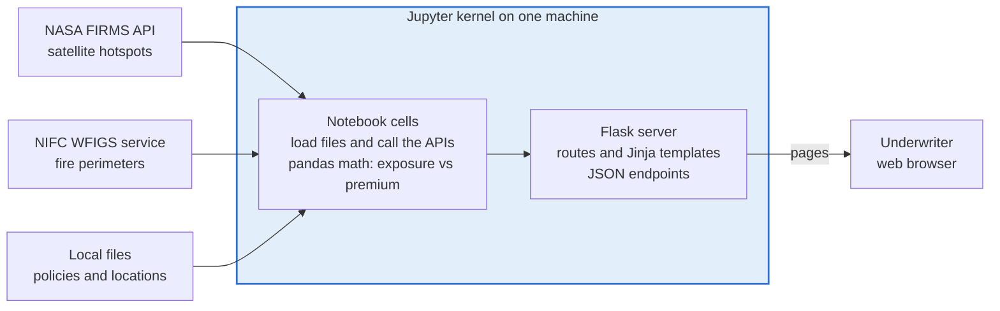
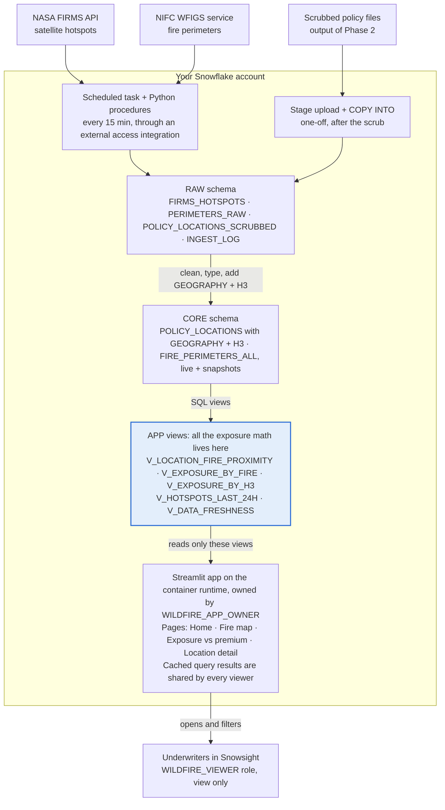
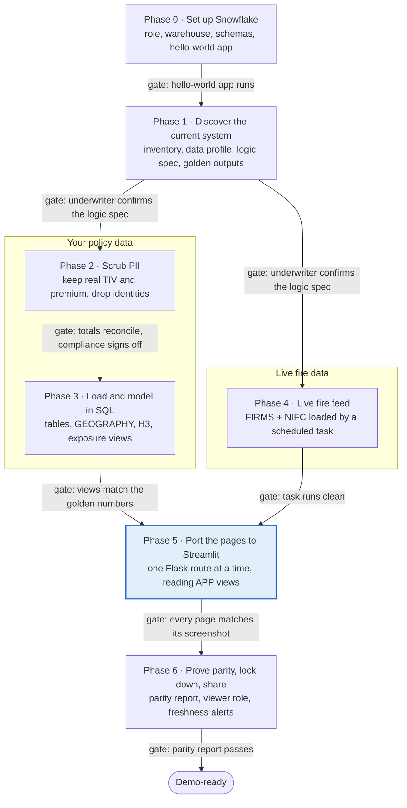

# Wildfire Underwriting App: Flask/Jupyter to Streamlit in Snowflake Runbook

*Last updated Oct 13, 2026 · Jim Ball*

> **Status: draft.** The fire-data sources assumed below (NASA FIRMS hotspots and NIFC/WFIGS perimeters) are known to be wrong for this system. Phases 1 and 4, prompt P-7 and the diagrams will be revised once the actual feeds are confirmed. The rest of the runbook does not depend on which feed is used.

## How to use this runbook

You will rebuild the wildfire exposure tool as a Streamlit app that lives inside Snowflake, in seven phases, each ending with a check you can tick off before moving on. You don't need to know Snowflake well to start: Phase 0 walks through every click to get a hello-world app running.

**Who this is for:** someone comfortable with Python, pandas and Flask, new to Snowflake and Streamlit in Snowflake (SiS).

**What I assumed about your current system** (I can't see the notebook or Flask code, so Phase 1 confirms or corrects each of these):

- A Jupyter notebook loads policy and location data (CSV, Excel or a database) with coordinates, total insured value (TIV), premium and policy attributes.
- The notebook or Flask pulls live wildfire data over HTTP, most likely NASA FIRMS hotspots and/or NIFC fire perimeters.
- Python logic measures each location's proximity to active fires, totals exposure by zone, and compares that exposure with the premium written.
- Flask serves HTML pages (a map, tables, a decision view) and maybe JSON endpoints, started from a notebook cell.

**How to work through it:**

1. Read the two diagrams in the next sections first; they show where every piece of today's app ends up.
2. Do the phases in order. Don't skip Phase 0, even if it feels basic; most first-time SiS problems are role and privilege problems.
3. When a phase says "run prompt P-n", copy that prompt from the [Prompt library](PROMPT_LIBRARY.md) into Claude Opus (or a model of similar strength) in a session where your notebook, Flask code and data samples are attached. The prompts are written to be run where the code lives, since I can't reach it from here.
4. Never paste raw policyholder data into an AI tool your company hasn't approved for PII. If in doubt, run the discovery prompts on column names and a few fake rows first, then on real data only inside an approved environment.
5. Keep a running "decisions log" (a simple list of what you chose and why). The parity test in Phase 6 depends on it.

## Where everything goes

Every job the notebook kernel does today moves to its own Snowflake object, and the app shrinks to something that only reads views.

*Today: one notebook kernel fetches, computes and serves everything (as assumed before Phase 1 confirms it).*



Today the kernel is the whole system: it pulls the feeds, holds the data in memory, does the math and serves the pages.

*Target: Snowflake loads and computes; the app only reads views. Everything inside the box runs in your Snowflake account, under Snowflake roles.*



In Snowflake each job gets its own home: tasks load the feeds, SQL views hold the exposure math, and the Streamlit app reads only the APP views.

### Translation table

| In your current setup | In Streamlit in Snowflake | Phase |
| --- | --- | --- |
| `flask run` started from a notebook cell | An always-on app object, opened from **Projects** » **Streamlit** | 0 |
| `pip install` in the kernel | `pyproject.toml` (container runtime) or `environment.yml` (warehouse runtime) | 0, 5 |
| A cell that reads a CSV or Excel file | A stage upload plus `COPY INTO` a RAW table | 3 |
| pandas exposure-vs-premium math | SQL views in the APP schema; Python only where SQL can't do it | 3 |
| `requests.get()` to FIRMS or NIFC | A Python stored procedure with an external access integration, run by a task | 4 |
| API key in `.env` or in code | A Snowflake SECRET object | 4 |
| APScheduler or a background thread | A Snowflake task | 4 |
| A DataFrame held in memory between requests | Snowflake tables, plus `conn.query(..., ttl=...)` caching | 5 |
| `@app.route("/map")` | A file in the `pages/` folder | 5 |
| `request.args` and form fields | `st.selectbox`, `st.slider`, `st.date_input`, grouped in `st.form` | 5 |
| Jinja template | Streamlit layout: `st.columns`, `st.tabs`, `st.metric`, `st.dataframe` | 5 |
| Folium or Leaflet map | `st.pydeck_chart` with scatter, GeoJSON and H3 hexagon layers | 5 |
| JSON endpoint other systems call | A Snowflake view those systems query; SiS apps don't serve APIs | 5 |
| Flask login | Snowflake roles and app sharing | 6 |

## The journey at a glance

Seven phases, each closed by a gate taken from its exit check; your policy data and the live fire feed are separate tracks that meet when you build the app.

*Your data and the fire feed move in parallel, then meet in the app. Each labelled arrow is a gate: don't start the next phase until its check passes.*



Phase 4 doesn't depend on Phases 2 and 3, so if a colleague can take the fire feed, the two tracks run side by side. The rough effort figures in each phase add up to about 13 to 20 working days for one person.

## Phase 0: Set up Snowflake and ship a hello-world app

By the end of this phase you have your own role, warehouse and database, and a starter Streamlit app running in Snowflake, before any wildfire code moves. Rough effort: half a day, mostly waiting on your admin for grants.

### 0.1 Find out what you're working with

Open Snowsight (the Snowflake web UI), start a SQL worksheet and run:

```sql
SELECT CURRENT_ACCOUNT(), CURRENT_REGION(), CURRENT_ROLE(), CURRENT_WAREHOUSE();
SHOW GRANTS TO ROLE IDENTIFIER(CURRENT_ROLE());
```

Then ask your Snowflake admin three questions:

1. **Which edition are we on?** Sensitive data classification needs Enterprise Edition or higher, and so do masking policies. Standard Edition still works for everything else in this runbook. ([Snowflake docs](https://docs.snowflake.com/en/user-guide/classify-intro))
2. **Has the essential security setup for Streamlit been done?** Snowflake lists it as a prerequisite before anyone creates an app. ([Getting started](https://docs.snowflake.com/en/developer-guide/streamlit/getting-started/overview))
3. **Are we in a government region?** Container runtimes aren't supported there; you'd use the warehouse runtime instead. ([Runtime environments](https://docs.snowflake.com/en/developer-guide/streamlit/app-development/runtime-environments))

### 0.2 Have your admin run this setup script

Send this to your admin as-is. It creates a development role you own, a small warehouse that shuts itself off, and a database you control. Replace `<YOUR_USER>`.

```sql
USE ROLE ACCOUNTADMIN;

-- 1. A role for you
CREATE ROLE IF NOT EXISTS WILDFIRE_DEV;
GRANT ROLE WILDFIRE_DEV TO USER <YOUR_USER>;

-- 2. A small warehouse that suspends after 60 idle seconds
CREATE WAREHOUSE IF NOT EXISTS WILDFIRE_WH
  WAREHOUSE_SIZE = 'XSMALL'
  AUTO_SUSPEND = 60
  AUTO_RESUME = TRUE
  INITIALLY_SUSPENDED = TRUE;
GRANT USAGE ON WAREHOUSE WILDFIRE_WH TO ROLE WILDFIRE_DEV;

-- 3. A database your role owns
CREATE DATABASE IF NOT EXISTS WILDFIRE_DB;
GRANT OWNERSHIP ON DATABASE WILDFIRE_DB TO ROLE WILDFIRE_DEV;

-- 4. Container runtime: compute pool + Python packages from PyPI
GRANT USAGE ON COMPUTE POOL SYSTEM_COMPUTE_POOL_CPU TO ROLE WILDFIRE_DEV;  -- skip if your role can already use it
GRANT DATABASE ROLE SNOWFLAKE.PYPI_REPOSITORY_USER TO ROLE WILDFIRE_DEV;

-- 5. Needed later for the scheduled fire-data refresh (Phase 4)
GRANT EXECUTE TASK ON ACCOUNT TO ROLE WILDFIRE_DEV;
```

The compute pool and PyPI grants come straight from Snowflake's [dependency management](https://docs.snowflake.com/en/developer-guide/streamlit/app-development/dependency-management) and [privileges](https://docs.snowflake.com/en/developer-guide/streamlit/object-management/privileges) pages. Snowflake sets up a general-purpose compute pool in every account, so line 4's first grant is often unnecessary.

### 0.3 Create your schemas (you can do this yourself)

Once the admin is done, switch to your new role and build the three layers this runbook uses:

```sql
USE ROLE WILDFIRE_DEV;
USE WAREHOUSE WILDFIRE_WH;

CREATE SCHEMA IF NOT EXISTS WILDFIRE_DB.RAW;   -- data exactly as it arrives (fire feeds, uploads)
CREATE SCHEMA IF NOT EXISTS WILDFIRE_DB.CORE;  -- cleaned, scrubbed, typed tables
CREATE SCHEMA IF NOT EXISTS WILDFIRE_DB.APP;   -- views the Streamlit app reads, and the app itself
```

Think of RAW / CORE / APP as "inbox / filing cabinet / display case". The app only ever reads from APP.

### 0.4 Pick a runtime (container, unless something blocks it)

Streamlit in Snowflake runs your app in one of two ways. Container runtime is the better fit here, because underwriters share one live app and cached fire data is shared between them.

|  | Container runtime (recommended) | Warehouse runtime (fallback) |
| --- | --- | --- |
| How it runs | One shared, long-running app for all viewers | A fresh personal copy per viewer |
| Caching | Shared across all viewers | Only within one viewer's session |
| Python packages | Any PyPI package (via the artifact repository) | Only the Snowflake Anaconda channel |
| Python version | 3.11 | 3.9, 3.10 or 3.11 |
| Largest data sent to the browser | 200 MB default, configurable | 32 MB, fixed |
| Idle behavior | Suspends after three days with no viewers | Sleep timer you configure |
| Gotcha | Subject to compute-pool maintenance windows | Slower first load per viewer |

Source: [Runtime environments](https://docs.snowflake.com/en/developer-guide/streamlit/app-development/runtime-environments) and [Limitations](https://docs.snowflake.com/en/developer-guide/streamlit/limitations).

### 0.5 Ship the hello-world app

1. In Snowsight, select **Workspaces** in the left menu and open a workspace.
2. Select **+ Add new** » **Streamlit app**. Snowflake creates a folder with starter files and opens the editor.
3. Select **Run**. You should see the example app on the right.
4. Replace the contents of `streamlit_app.py` with the snippet below and select **Run** again.
5. Deploy it into `WILDFIRE_DB.APP` (follow Snowflake's [create and run in a workspace](https://docs.snowflake.com/developer-guide/streamlit/streamlit-in-workspaces/streamlit-in-workspaces-create-run) steps), choosing `WILDFIRE_WH` as the query warehouse.
6. Open it from **Projects** » **Streamlit** to confirm the deployed copy works.

```python
import streamlit as st

st.title("Wildfire exposure: hello world")

conn = st.connection("snowflake")
df = conn.query(
    "select current_user() as user_name, current_role() as role_name, current_warehouse() as wh"
)
st.dataframe(df)
st.success("If you can see your user and role above, Snowflake and Streamlit are talking.")
```

Prefer the command line? The [Snowflake CLI](https://docs.snowflake.com/en/developer-guide/streamlit/getting-started/overview) does the same with `snow init`, a `snowflake.yml` file and `snow streamlit deploy --open`. Stick with Workspaces until the app works; switch later if you want Git-driven deploys.

### Phase 0 exit check

- [ ] You can run `USE ROLE WILDFIRE_DEV;` and `USE WAREHOUSE WILDFIRE_WH;` without errors
- [ ] Schemas RAW, CORE and APP exist in WILDFIRE\_DB
- [ ] The hello-world app is deployed and shows your user and role
- [ ] You know your edition and which runtime you're using

## Phase 1: Discover what the current system really does

This phase turns the notebook and Flask code into three written documents (an inventory, a data profile and a logic spec) plus a set of "golden" numbers that the new app must reproduce. Rough effort: 2 to 3 days, most of it the AI-assisted analysis and one review with an underwriter.

### 1.1 Gather everything into one working folder

Do this on the machine (or approved environment) where the running system lives. Don't email any of it around.

| Put in the folder | How to get it | Why it matters |
| --- | --- | --- |
| The notebook, saved **with outputs** | In Jupyter: File » Save, then copy the `.ipynb` | Outputs show real shapes and values the code produced |
| All Flask files | `app.py` (or similar), `templates/`, `static/`, any helper `.py` modules | Routes and templates tell you what users see |
| Exact package list | In a notebook cell: `!pip freeze > requirements_current.txt` | Shows map, geo and data libraries you must replace or keep |
| Config with secrets removed | Copy `.env` or config files, then replace every key with `REDACTED` | Reveals API endpoints, file paths, thresholds |
| Data samples from the running system | Export each input dataset (policies/locations, fire snapshots, rate tables) | The analysis runs on these |
| Screenshots of every page | One per Flask route, plus any filter states underwriters use | Your visual target for the Streamlit port |
| Golden outputs | For 2 or 3 dates, save the tables, totals and decisions the app showed (CSV + screenshot) | Phase 6 proves parity against these |

**Golden outputs are the most important thing on this list.** Pick dates when fires were active near insured locations, so the numbers are interesting and the test is meaningful.

### 1.2 Run the three discovery prompts, in order

Each prompt is in the [Prompt library](PROMPT_LIBRARY.md). Start a fresh AI session for each one, paste the shared context block first, then the prompt, then attach the files it asks for.

1. **P-1 System inventory.** Produces `SYSTEM_INVENTORY.md`: every route, data source, API call, transformation, output, library and piece of hidden state, with file and cell references.
2. **P-2 Data profiling and decision drivers.** Produces `DATA_PROFILE.md`: each dataset's schema, row counts, keys, nulls, ranges and joins, plus a ranked list of the fields that actually drive the underwriting decision.
3. **P-3 Business logic spec and golden tests.** Produces `LOGIC_SPEC.md` (every formula, threshold and band in plain language and pseudocode) and `golden_tests/`, a set of input-to-expected-output cases.

### 1.3 What "important" means for this app

Point the prompts at these questions; they decide what survives the migration and what gets dropped:

- **Exposure definition:** Which value counts as exposure (TIV, building only, limit, PML)? Is it summed per location, per policy or per account?
- **Proximity rules:** Distance to a hotspot, to a perimeter edge, or inside a perimeter? Which distance bands (for example 1, 5, 10 miles), and are they hard-coded?
- **Premium comparison:** Is it premium per $1,000 of TIV, a ratio to modeled loss, or a threshold flag? Is premium annual or earned to date?
- **Fire data choices:** Which FIRMS satellites and confidence levels? How far back in time? Do perimeters override hotspots?
- **Decision output:** What does the underwriter do with the result: decline, refer, adjust rate, add a deductible, or just watch?
- **Dead code:** Which notebook cells are experiments nobody uses? Leaving them out is the biggest time saver in Phase 5.

### 1.4 Review the logic spec with an underwriter (30 minutes)

Walk one underwriter through `LOGIC_SPEC.md` and the golden outputs. Ask three questions: "Is this how you read the screen?", "What do you look at first?" and "What's missing that you work out by hand?" Record their answers in your decisions log. The answers often reveal a filter or rule that lives in someone's head rather than in the code.

### Phase 1 exit check

- [ ] `SYSTEM_INVENTORY.md`, `DATA_PROFILE.md` and `LOGIC_SPEC.md` exist and you've read them end to end
- [ ] Golden outputs saved for at least 2 dates
- [ ] An underwriter has confirmed the logic spec, or you've noted their corrections
- [ ] You have a list of every external URL the system calls (needed for Phase 4)

## Phase 2: Scrub PII but keep the real exposure numbers

Remove or replace everything that identifies a policyholder, keep TIV, premium, limits and deductibles exact, and coarsen each location just enough that it can't be traced to a parcel while distance-to-fire results stay the same. Rough effort: 2 to 4 days including compliance review.

**Before you start:** confirm with your privacy or compliance team that this data may be used for the demo at all, and whether "the customer" seeing it changes anything. Scrubbed data from one carrier shown to a different company can still breach a data-use agreement, even with every name removed.

### 2.1 Decide where the scrub happens

| Your Snowflake account is... | Do this | Why |
| --- | --- | --- |
| A demo or sandbox account | Scrub **before** loading, inside the environment where the running system lives; load only scrubbed files | Raw PII never enters the demo account |
| Your company's governed production account | Load raw into a locked-down RAW schema, scrub with SQL into CORE, protect RAW with masking policies | Keeps the scrub auditable and repeatable as data refreshes |

If you're not sure which you have, assume the first and scrub before loading.

### 2.2 Treatment for each kind of field

| Field group | Typical columns | Treatment | Real value kept? |
| --- | --- | --- | --- |
| Direct identifiers | Insured name, contact name, email, phone, FEIN/SSN | Drop the column, or replace with fake values (Python `Faker`, fixed seed) if a page displays a name | No |
| Record keys | Policy number, location ID, account ID, claim number | Replace with a salted hash token (HMAC-SHA256, secret salt kept outside the demo) so joins still work | No, but relationships kept |
| Street address | Street line, unit, full address string | Drop. Keep state and county; keep ZIP only at 3 digits if a page needs it | Partly |
| Coordinates | Latitude, longitude | Snap or jitter (see 2.3). Never ship raw coordinates | Approximate |
| Money and limits | TIV, building/contents/BI values, premium, deductible, limits | Keep exact; cap or band only the outlier risks flagged in 2.4 | **Yes** |
| Risk attributes | Construction, occupancy, year built, roof, wildfire score, defensible space | Keep. Band year built to 5-year groups only if 2.4 flags it | Yes |
| Dates | Inception, expiry, last inspection | Keep month and year, or shift every date by the same offset | Mostly |
| People on your side | Underwriter, broker, agent names | Replace with tokens or role labels ("Underwriter A") | No |
| Free text | Notes, inspection comments, emails | Drop. Free text is where PII hides | No |
| Fire data | FIRMS hotspots, NIFC perimeters | Keep as is. It's public data with no policyholder information | Yes |

### 2.3 Location: the one field that needs care

Exposure depends on how far each location is from a fire, so coordinates can't simply be deleted. Pick one method and stick to it:

- **Snap to an H3 cell centre (recommended).** Replace each point with the centre of its H3 hexagon. At resolution 9 the average cell is about 0.105 km² with edges about 0.2 km long, so a point moves at most about 0.2 to 0.3 km (cells vary in size). At resolution 8 cells average about 0.74 km² and edges about 0.53 km. ([H3 cell statistics](https://h3geo.org/docs/core-library/restable/))
- **Deterministic jitter.** Move each point a seeded random distance (for example 50 to 200 m) in a random direction. Use a fixed seed so reruns give the same result.

Rule of thumb: the largest move must be much smaller than the narrowest distance band in `LOGIC_SPEC.md`. If the app bands at 1 mile (about 1.6 km), resolution 9 is safe; resolution 8 is borderline for locations sitting right on a band edge.

Then measure it. For every golden date, recompute the distance band of every location with the scrubbed coordinates and compare with the original. Report how many locations changed band and how much TIV moved. If more than a handful moved, go one resolution finer.

### 2.4 Watch for outliers that identify themselves

A single $180M location in a rural county is identifiable from its TIV alone, even with no name. Have the scrub flag:

- Any location whose TIV is in the top 1% of the portfolio
- Any H3 cell (resolution 7) or county containing fewer than 5 locations
- Any combination of county + occupancy + year-built band shared by fewer than 5 locations (a basic k-anonymity check)

For flagged rows, round TIV to 2 significant figures or move the location to the cell centre at resolution 7. Portfolio totals still reconcile if you record the adjustment in a reconciliation table.

### 2.5 Build and run the scrub

1. Run **P-4 PII discovery and treatment plan** on column names and the profile from Phase 1. It produces `PII_TREATMENT_PLAN.md`, one row per column with its treatment.
2. Review that plan yourself and with compliance. This is the decision record.
3. Run **P-5 Scrub script and validation**. It produces `scrub.py` (or SQL if you scrub inside Snowflake) and a `SCRUB_VALIDATION_REPORT.md`.
4. Run **P-10 Adversarial leak review** in a fresh session that hasn't seen your work. It tries to re-identify records and reports what it found.

### 2.6 Prove nothing broke and nothing leaked

The validation report must show all of these:

- **Totals match exactly, apart from the outlier adjustments recorded in 2.4:** location count, total TIV and total premium, overall and by state, county and line of business.
- **Band shift is small:** count and TIV of locations whose distance band changed (target: zero or near zero).
- **No identifiers survive:** regex scan of every text column for emails, phone numbers, SSN/FEIN patterns and street-address patterns returns zero hits; no scrubbed key matches any raw key.
- **Small groups handled:** every flagged outlier from 2.4 is listed with what was done to it.

If you're on Enterprise Edition, add Snowflake's own check after loading: `CALL SYSTEM$CLASSIFY('WILDFIRE_DB.CORE.POLICY_LOCATIONS', null);` lists columns Snowflake thinks contain identifiers or quasi-identifiers. Run it while latitude and longitude are still FLOAT columns, because GEOGRAPHY columns can't be classified. ([Classification](https://docs.snowflake.com/en/user-guide/classify-intro), [SYSTEM$CLASSIFY](https://docs.snowflake.com/sql-reference/stored-procedures/system_classify))

### Phase 2 exit check

- [ ] `PII_TREATMENT_PLAN.md` approved by compliance (name and date in your decisions log)
- [ ] Validation report shows totals reconcile exactly and band shift is near zero
- [ ] Leak review (P-10) found nothing, or every finding is fixed
- [ ] The salt and any raw-to-token lookup are stored outside the demo environment

## Phase 3: Load the data and move the math into SQL

The scrubbed policy data and the saved fire snapshots go into Snowflake tables, and the notebook's exposure math becomes a handful of SQL views; the app will only read those views. Rough effort: 2 to 3 days. Run **P-6 Snowflake data model** to generate the exact DDL for your columns; the SQL below shows the shape it should take.

### 3.1 Upload the files

1. Have the scrub script write CSVs with **UPPER\_SNAKE\_CASE headers** (for example `LOCATION_TOKEN`, `TIV`). Lowercase headers become case-sensitive column names that need quotes forever after.
2. Create a stage (a folder inside Snowflake) and a file format:

```sql
USE ROLE WILDFIRE_DEV;
USE WAREHOUSE WILDFIRE_WH;

CREATE STAGE IF NOT EXISTS WILDFIRE_DB.RAW.UPLOADS;
CREATE FILE FORMAT IF NOT EXISTS WILDFIRE_DB.RAW.CSV_HEADER
  TYPE = CSV
  PARSE_HEADER = TRUE
  FIELD_OPTIONALLY_ENCLOSED_BY = '"';
```

3. In Snowsight, open **Data** » **Databases** » WILDFIRE\_DB » RAW » **Stages** » UPLOADS and use **+ Files** to upload the CSVs. (Snowsight's load-data wizard can also create the table for you; either route is fine.)
4. Create each table from the file's own header and load it:

```sql
CREATE OR REPLACE TABLE WILDFIRE_DB.RAW.POLICY_LOCATIONS_SCRUBBED
  USING TEMPLATE (
    SELECT ARRAY_AGG(OBJECT_CONSTRUCT(*))
    FROM TABLE(INFER_SCHEMA(
      LOCATION    => '@WILDFIRE_DB.RAW.UPLOADS/policy_locations_scrubbed.csv',
      FILE_FORMAT => 'WILDFIRE_DB.RAW.CSV_HEADER')));

COPY INTO WILDFIRE_DB.RAW.POLICY_LOCATIONS_SCRUBBED
  FROM @WILDFIRE_DB.RAW.UPLOADS/policy_locations_scrubbed.csv
  FILE_FORMAT = (FORMAT_NAME = 'WILDFIRE_DB.RAW.CSV_HEADER')
  MATCH_BY_COLUMN_NAME = CASE_INSENSITIVE;

SELECT COUNT(*), SUM(TIV), SUM(PREMIUM) FROM WILDFIRE_DB.RAW.POLICY_LOCATIONS_SCRUBBED;
-- These three numbers must equal the scrub validation report. Stop here if they don't.
```

### 3.2 Build the core tables

Column names below are placeholders; P-6 swaps in yours.

```sql
CREATE OR REPLACE TABLE WILDFIRE_DB.CORE.POLICY_LOCATIONS AS
SELECT
  LOCATION_TOKEN,
  POLICY_TOKEN,
  STATE,
  COUNTY,
  LATITUDE::FLOAT                                   AS LATITUDE,
  LONGITUDE::FLOAT                                  AS LONGITUDE,
  ST_MAKEPOINT(LONGITUDE, LATITUDE)                 AS GEO,    -- longitude comes FIRST
  H3_LATLNG_TO_CELL_STRING(LATITUDE, LONGITUDE, 7)  AS H3_R7,  -- latitude comes FIRST
  TIV::NUMBER(18,2)                                 AS TIV,
  PREMIUM::NUMBER(18,2)                             AS PREMIUM,
  CONSTRUCTION,
  OCCUPANCY,
  YEAR_BUILT
FROM WILDFIRE_DB.RAW.POLICY_LOCATIONS_SCRUBBED;
```

The opposite argument orders of `ST_MAKEPOINT` and `H3_LATLNG_TO_CELL_STRING` are the single most common geospatial bug. If your map shows the portfolio in Antarctica, this is why.

Load the fire snapshots you saved from the running system the same way, into `CORE.FIRE_PERIMETERS_SNAPSHOT` and `CORE.FIRE_HOTSPOTS_SNAPSHOT`, each with a `SNAPSHOT_TS` column. These let the demo replay the exact fire situation behind your golden outputs. Perimeter geometry usually arrives as GeoJSON; convert it with `TRY_TO_GEOGRAPHY(<geojson>)`, which returns NULL for invalid shapes instead of failing the whole load, then count the NULLs.

### 3.3 Turn the exposure math into views

Three views carry almost all of the app. Replace the distance bands and the premium metric with the ones in `LOGIC_SPEC.md`.

```sql
-- Every location within 10 miles of a fire, with its distance band
CREATE OR REPLACE VIEW WILDFIRE_DB.APP.V_LOCATION_FIRE_PROXIMITY AS
SELECT
  l.LOCATION_TOKEN,
  f.INCIDENT_ID,
  f.SNAPSHOT_TS,
  ST_DISTANCE(l.GEO, f.GEO) / 1609.344 AS MILES_TO_PERIMETER,  -- GEOGRAPHY distances are in metres
  CASE
    WHEN ST_INTERSECTS(l.GEO, f.GEO)          THEN '0 Inside perimeter'
    WHEN ST_DWITHIN(l.GEO, f.GEO, 1 * 1609.344) THEN '1 Within 1 mi'
    WHEN ST_DWITHIN(l.GEO, f.GEO, 5 * 1609.344) THEN '2 1 to 5 mi'
    ELSE                                            '3 5 to 10 mi'
  END AS DISTANCE_BAND,
  l.TIV,
  l.PREMIUM
FROM WILDFIRE_DB.CORE.POLICY_LOCATIONS l
JOIN WILDFIRE_DB.CORE.FIRE_PERIMETERS_ALL f      -- live + snapshot perimeters, see Phase 4
  ON ST_DWITHIN(l.GEO, f.GEO, 10 * 1609.344);

-- Exposure vs premium per fire and band
CREATE OR REPLACE VIEW WILDFIRE_DB.APP.V_EXPOSURE_BY_FIRE AS
SELECT
  INCIDENT_ID,
  SNAPSHOT_TS,
  DISTANCE_BAND,
  COUNT(*)                                              AS LOCATIONS,
  SUM(TIV)::FLOAT                                       AS TOTAL_TIV,
  SUM(PREMIUM)::FLOAT                                   AS TOTAL_PREMIUM,
  (SUM(PREMIUM) / NULLIF(SUM(TIV) / 1000, 0))::FLOAT    AS PREMIUM_PER_1K_TIV
FROM WILDFIRE_DB.APP.V_LOCATION_FIRE_PROXIMITY
GROUP BY INCIDENT_ID, SNAPSHOT_TS, DISTANCE_BAND;

-- Portfolio exposure on hexagons, for the map (also hides individual points)
CREATE OR REPLACE VIEW WILDFIRE_DB.APP.V_EXPOSURE_BY_H3 AS
SELECT
  H3_R7                 AS HEX,
  COUNT(*)              AS LOCATIONS,
  SUM(TIV)::FLOAT       AS TOTAL_TIV,
  SUM(PREMIUM)::FLOAT   AS TOTAL_PREMIUM
FROM WILDFIRE_DB.CORE.POLICY_LOCATIONS
GROUP BY H3_R7;
```

A location near two fires appears once per fire, which is right for the per-fire view. For portfolio-level totals, keep only each location's nearest fire with `QUALIFY ROW_NUMBER() OVER (PARTITION BY LOCATION_TOKEN, SNAPSHOT_TS ORDER BY MILES_TO_PERIMETER) = 1`, or you'll double-count.

The `::FLOAT` casts are deliberate: they stop Snowflake's exact decimals from breaking charts and maps later.

### 3.4 Check the views against your golden numbers now

Don't wait for the app. For each golden date, query `V_EXPOSURE_BY_FIRE` filtered to that snapshot and compare with what the Flask app showed. Differences here are logic or scrub problems, and they're far easier to fix in SQL than after they're buried in a UI.

If the proximity view is slow (many locations times many perimeters), two upgrades help: pre-filter by H3 cell before the distance test, or turn the view into a dynamic table that refreshes on a schedule. P-6 covers both.

### Phase 3 exit check

- [ ] Row counts and TIV/premium totals in Snowflake match the scrub validation report
- [ ] The portfolio lands in the right place (spot-check 5 locations on a map)
- [ ] Views return results for every golden date, and the numbers match the golden outputs within the band-shift tolerance from Phase 2

## Phase 4: Bring the live wildfire feeds into Snowflake

A scheduled Python stored procedure fetches FIRMS hotspots and NIFC perimeters into RAW tables every 15 minutes, and the app only ever reads those tables. Rough effort: 1 to 2 days. Run **P-7 Live fire ingestion** to harden the starter code below for your feeds.

**Why not call the APIs from the app, like Flask did?** On the warehouse runtime every viewer gets a separate copy of the app, so each would hit the APIs. Streamlit also reruns the script on every click. A scheduled load gives every underwriter the same snapshot, keeps API keys out of app code, and respects the feeds' limits. NIFC explicitly asks users not to query its perimeter service repeatedly. ([WFIGS service notes](https://databasin.org/datasets/24eda9b68d534806a2ac104d9b6354c8))

### 4.1 Get a FIRMS map key

Request a free MAP\_KEY on the [FIRMS API page](https://firms.modaps.eosdis.nasa.gov/api/area/). What you need to know about it:

- The area API URL is `/api/area/csv/[MAP_KEY]/[SOURCE]/[west,south,east,north]/[DAY_RANGE]`, with a day range of 1 to 5.
- A key allows 5,000 transactions per 10-minute interval, far more than a 15-minute schedule uses.
- VIIRS sources are `VIIRS_NOAA20_NRT`, `VIIRS_NOAA21_NRT` and `VIIRS_SNPP_NRT`. Real-time and ultra-real-time detections are replaced once the standard near-real-time detection is processed, so the same fire can arrive twice; the view below de-duplicates.
- FIRMS can deliver ultra-real-time US and Canada detections within about a minute of a satellite pass.

### 4.2 Have your admin open the network door

Snowflake blocks outbound internet by default. A network rule names the hosts, a secret holds the key, and an external access integration (EAI) ties them together ([Snowflake external access](https://docs.snowflake.com/en/developer-guide/streamlit/features/external-access)). Use the exact perimeter host from your Phase 1 URL list.

```sql
USE ROLE ACCOUNTADMIN;

CREATE OR REPLACE NETWORK RULE WILDFIRE_DB.RAW.FIRE_FEEDS_RULE
  MODE = EGRESS
  TYPE = HOST_PORT
  VALUE_LIST = ('firms.modaps.eosdis.nasa.gov', '<NIFC_PERIMETER_HOST_FROM_PHASE_1>');

CREATE OR REPLACE SECRET WILDFIRE_DB.RAW.FIRMS_MAP_KEY
  TYPE = GENERIC_STRING
  SECRET_STRING = '<YOUR_FIRMS_MAP_KEY>';

CREATE OR REPLACE EXTERNAL ACCESS INTEGRATION FIRE_FEEDS_EAI
  ALLOWED_NETWORK_RULES = (WILDFIRE_DB.RAW.FIRE_FEEDS_RULE)
  ALLOWED_AUTHENTICATION_SECRETS = (WILDFIRE_DB.RAW.FIRMS_MAP_KEY)
  ENABLED = TRUE;

GRANT READ ON SECRET WILDFIRE_DB.RAW.FIRMS_MAP_KEY TO ROLE WILDFIRE_DEV;
GRANT USAGE ON INTEGRATION FIRE_FEEDS_EAI TO ROLE WILDFIRE_DEV;
```

### 4.3 Create the hotspot loader

```sql
USE ROLE WILDFIRE_DEV;
USE WAREHOUSE WILDFIRE_WH;

CREATE OR REPLACE PROCEDURE WILDFIRE_DB.RAW.LOAD_FIRMS(SOURCES STRING, BBOX STRING, DAY_RANGE INT)
  RETURNS STRING
  LANGUAGE PYTHON
  RUNTIME_VERSION = '3.11'
  PACKAGES = ('snowflake-snowpark-python', 'requests', 'pandas')
  HANDLER = 'run'
  EXTERNAL_ACCESS_INTEGRATIONS = (FIRE_FEEDS_EAI)
  SECRETS = ('firms_key' = WILDFIRE_DB.RAW.FIRMS_MAP_KEY)
AS
$$
import io
from datetime import datetime, timezone

import pandas as pd
import requests
import _snowflake

def run(session, sources, bbox, day_range):
    key = _snowflake.get_generic_secret_string("firms_key")
    loaded_at = datetime.now(timezone.utc).strftime("%Y-%m-%d %H:%M:%S")
    results = []
    for source in [s.strip() for s in sources.split(",")]:
        url = f"https://firms.modaps.eosdis.nasa.gov/api/area/csv/{key}/{source}/{bbox}/{day_range}"
        resp = requests.get(url, timeout=60)
        resp.raise_for_status()
        df = pd.read_csv(io.StringIO(resp.text))
        if df.empty:
            results.append(f"{source}: 0 rows")
            continue
        df.columns = [c.upper() for c in df.columns]
        df["SOURCE"] = source
        df["LOADED_AT_UTC"] = loaded_at
        session.write_pandas(df, "FIRMS_HOTSPOTS", database="WILDFIRE_DB", schema="RAW",
                             auto_create_table=True, overwrite=False)
        results.append(f"{source}: {len(df)} rows")
    return "; ".join(results)
$$;

-- Run it once by hand. The box is west,south,east,north (this example is roughly the western US);
-- replace it with your portfolio's bounding box plus a margin.
CALL WILDFIRE_DB.RAW.LOAD_FIRMS('VIIRS_NOAA20_NRT,VIIRS_NOAA21_NRT,VIIRS_SNPP_NRT', '-125,31,-102,49', 1);
```

Then give the app a clean, de-duplicated view of the last 24 hours. FIRMS acquisition times are in UTC.

```sql
CREATE OR REPLACE VIEW WILDFIRE_DB.APP.V_HOTSPOTS_LAST_24H AS
SELECT
  LATITUDE::FLOAT  AS LATITUDE,
  LONGITUDE::FLOAT AS LONGITUDE,
  FRP::FLOAT       AS FRP,
  CONFIDENCE,
  SOURCE,
  TO_TIMESTAMP_NTZ(ACQ_DATE || ' ' || LPAD(ACQ_TIME::STRING, 4, '0'), 'YYYY-MM-DD HH24MI') AS ACQ_TS_UTC
FROM WILDFIRE_DB.RAW.FIRMS_HOTSPOTS
WHERE ACQ_TS_UTC >= DATEADD(hour, -24, CONVERT_TIMEZONE('UTC', CURRENT_TIMESTAMP())::TIMESTAMP_NTZ)
QUALIFY ROW_NUMBER() OVER (
  PARTITION BY LATITUDE, LONGITUDE, ACQ_TS_UTC, SOURCE ORDER BY LOADED_AT_UTC DESC) = 1;
```

### 4.4 Create the perimeter loader

The perimeter loader follows the same pattern: a procedure named `LOAD_PERIMETERS` calls the WFIGS current-perimeters query endpoint your Flask code uses, asks for GeoJSON, and writes one row per fire (the feature as a JSON string plus `LOADED_AT_UTC`) into `RAW.PERIMETERS_RAW`. One row per fire matters: a whole national GeoJSON response can exceed what a single Snowflake value holds. P-7 writes this procedure, including paging through results.

Then one view stitches live and saved perimeters together, which is what the Phase 3 proximity view joins to:

```sql
CREATE OR REPLACE VIEW WILDFIRE_DB.CORE.FIRE_PERIMETERS_ALL AS
SELECT                                                        -- live: latest load only
  PARSE_JSON(FEATURE_JSON):properties                  AS ATTRS,
  ATTRS:<INCIDENT_ID_FIELD>::STRING                    AS INCIDENT_ID,   -- field name from P-7
  'LIVE'                                               AS MODE,
  TO_TIMESTAMP_NTZ(LOADED_AT_UTC)                      AS SNAPSHOT_TS,
  TRY_TO_GEOGRAPHY(PARSE_JSON(FEATURE_JSON):geometry)  AS GEO
FROM WILDFIRE_DB.RAW.PERIMETERS_RAW
WHERE LOADED_AT_UTC = (SELECT MAX(LOADED_AT_UTC) FROM WILDFIRE_DB.RAW.PERIMETERS_RAW)
UNION ALL
SELECT ATTRS, INCIDENT_ID, 'SNAPSHOT', SNAPSHOT_TS, GEO      -- saved: replays your golden dates
FROM WILDFIRE_DB.CORE.FIRE_PERIMETERS_SNAPSHOT;
```

This gives the app a **mode switch**: "Live" for current fires, or a saved snapshot for the demo. Snapshot mode matters more than it sounds. On demo day there may be no fires near the portfolio, and the customer will trust numbers they recognise from the running system.

### 4.5 Schedule it

```sql
CREATE OR REPLACE TASK WILDFIRE_DB.RAW.T_LOAD_FIRMS
  WAREHOUSE = WILDFIRE_WH
  SCHEDULE = '15 MINUTE'
AS
  CALL WILDFIRE_DB.RAW.LOAD_FIRMS('VIIRS_NOAA20_NRT,VIIRS_NOAA21_NRT,VIIRS_SNPP_NRT', '-125,31,-102,49', 1);

CREATE OR REPLACE TASK WILDFIRE_DB.RAW.T_LOAD_PERIMETERS
  WAREHOUSE = WILDFIRE_WH
  AFTER WILDFIRE_DB.RAW.T_LOAD_FIRMS
AS
  CALL WILDFIRE_DB.RAW.LOAD_PERIMETERS('<WFIGS_QUERY_URL_FROM_PHASE_1>');

-- Tasks start suspended. Resume the child first, then the root.
ALTER TASK WILDFIRE_DB.RAW.T_LOAD_PERIMETERS RESUME;
ALTER TASK WILDFIRE_DB.RAW.T_LOAD_FIRMS RESUME;

-- Check on it any time
SELECT NAME, STATE, SCHEDULED_TIME, ERROR_MESSAGE
FROM TABLE(WILDFIRE_DB.INFORMATION_SCHEMA.TASK_HISTORY())
ORDER BY SCHEDULED_TIME DESC
LIMIT 20;
```

Cost check: each run wakes the warehouse, and a resume bills at least one minute, so 96 runs a day on X-Small is roughly 1.6 credits a day. Outside fire season, a 30- or 60-minute schedule halves or quarters that. RAW tables grow with every load; P-7 adds a cleanup step that keeps 30 days.

### Phase 4 exit check

- [ ] Both procedures run by hand and return row counts
- [ ] Task history shows several successful runs in a row
- [ ] `V_HOTSPOTS_LAST_24H` returns recent points with no duplicates
- [ ] `FIRE_PERIMETERS_ALL` returns both LIVE and SNAPSHOT rows, with no NULL geometry left unexplained

## Phase 5: Rebuild the Flask pages in Streamlit

Each Flask route becomes a Streamlit page that reads one or two APP views, adds filters, and draws a map, chart or table; there is no server code to write. Rough effort: 3 to 5 days. Port one page at a time with **P-8 Flask to Streamlit port**, deploying after each.

### 5.1 The one mental shift

Flask waits for a request, runs one function and returns a page. Streamlit runs **your whole script from top to bottom every time someone touches a widget**. Three habits keep that fast:

1. **Push the heavy work into SQL views** (done in Phase 3). The app filters and draws; it doesn't compute exposure.
2. **Cache every query.** `conn.query(sql, ttl=600)` reuses a result for 10 minutes. On the container runtime the cache is shared by all viewers; on the warehouse runtime only within one viewer's session.
3. **Group related inputs in `st.form`** so a viewer can set five filters and click once, instead of triggering five reruns.

### 5.2 Lay out the project

```text
wildfire_app/
├── streamlit_app.py           # Home: portfolio totals, data freshness, live/snapshot switch
├── pages/
│   ├── 1_Fire_Map.py          # Fires + exposure hexagons
│   ├── 2_Exposure_vs_Premium.py  # Per-fire, per-band TIV vs premium
│   └── 3_Location_Detail.py   # Drill-down for one location token
├── lib/
│   ├── queries.py             # Every SQL string in one place
│   └── metrics.py             # Any logic that couldn't move to SQL, with unit tests
└── pyproject.toml             # Container runtime dependencies
```

Files in `pages/` become sidebar entries automatically, in filename order. Your page list comes from the Phase 1 inventory, not from this sketch.

A starting `pyproject.toml` for the container runtime (attach the built-in PyPI repository to the app so these install; see [dependency management](https://docs.snowflake.com/en/developer-guide/streamlit/app-development/dependency-management)):

```toml
[project]
name = "wildfire-exposure"
version = "0.1.0"
requires-python = ">=3.11"
dependencies = [
    "streamlit[snowflake]>=1.50",
    "pandas>=2.0",
    "pydeck>=0.9",
    "plotly>=5.0",
]
```

### 5.3 A working map page to start from

This page shows insured exposure as hexagons and the last 24 hours of hotspots on top. Get it running before porting anything else; it proves the views, the cache and the map all work.

```python
# pages/1_Fire_Map.py
import pydeck as pdk
import streamlit as st

st.title("Active fires vs. insured exposure")
conn = st.connection("snowflake")

hotspots = conn.query(
    "select LATITUDE, LONGITUDE, FRP from WILDFIRE_DB.APP.V_HOTSPOTS_LAST_24H", ttl=600
)
cells = conn.query(
    "select HEX, LOCATIONS, TOTAL_TIV, TOTAL_PREMIUM from WILDFIRE_DB.APP.V_EXPOSURE_BY_H3", ttl=3600
)

exposure = pdk.Layer(
    "H3HexagonLayer", cells, get_hexagon="HEX",
    get_fill_color="[255, 140, 0, 110]", extruded=False, pickable=True,
)
fires = pdk.Layer(
    "ScatterplotLayer", hotspots, get_position="[LONGITUDE, LATITUDE]",
    get_radius=750, get_fill_color="[200, 30, 0, 200]", pickable=True,
)

st.pydeck_chart(pdk.Deck(
    layers=[exposure, fires],
    initial_view_state=pdk.ViewState(latitude=38.5, longitude=-120.5, zoom=5.5),
    tooltip={"text": "Locations: {LOCATIONS}\nTIV: {TOTAL_TIV}\nPremium: {TOTAL_PREMIUM}"},
))

st.caption(f"{len(hotspots):,} hotspots in the last 24 hours · {len(cells):,} exposure cells")
```

Snowflake returns column names in UPPERCASE, so the layers refer to `LATITUDE`, not `latitude`. On the warehouse runtime, maps need someone to acknowledge Snowflake's External Offerings Terms for the Mapbox and Carto basemap tiles; the container runtime doesn't. ([Limitations](https://docs.snowflake.com/en/developer-guide/streamlit/limitations))

### 5.4 Translate the rest page by page

For each Flask route, in the order underwriters use them:

1. Paste the route function, its template and the matching section of `LOGIC_SPEC.md` into P-8.
2. Check that every query it writes targets an APP view. If it needs a new view, add it to SQL first.
3. Paste the result into the workspace, select **Run**, and compare with the Flask screenshot.
4. Put the screenshot and the new page side by side and list differences in your decisions log. Fix or accept each one.
5. Deploy and move to the next route.

Two Flask features have no direct Streamlit equivalent. **JSON endpoints** that other systems call can't live in a Streamlit app; point those consumers at a Snowflake view instead, or keep a small API elsewhere. **Login code** goes away entirely: Snowflake's roles decide who can open the app (Phase 6).

### Phase 5 exit check

- [ ] Every Flask route from the inventory is a page, or is on a written "dropped" list with a reason
- [ ] No page calls an external API directly; all data comes from APP views
- [ ] The live/snapshot switch on the home page changes every page's numbers
- [ ] Each page loads in a few seconds after the first visit (the cache is working)

## Phase 6: Prove parity, lock it down, share it, keep it running

The app is done when its numbers match the golden outputs, it runs under a role that can see only the APP views, the right people can open it, and someone gets told when the fire feed stops. Rough effort: 2 days.

### 6.1 Prove parity

Run **P-9 Parity test harness**. It writes a script that queries the APP views for each golden date and compares them with the saved Flask outputs, then writes `PARITY_REPORT.md`.

| What is compared | Pass rule |
| --- | --- |
| Location counts, total TIV, total premium (portfolio, state, county) | Exact match, apart from the outlier adjustments recorded in Phase 2 |
| Exposure per fire and distance band | Within the band-shift tolerance measured in Phase 2 |
| Premium-to-exposure metric per fire | Within 0.5% (or whatever the underwriter agrees counts as "the same") |
| Decisions or flags (refer, decline, watch) | Same flag for every fire and location in the golden set |

Every failure gets one of three labels in the report: a bug (fix it), a scrub effect (explain it), or a deliberate change (record it in the decisions log).

### 6.2 Run the app under a role that sees only what it shows

Streamlit apps run with the **owner's** privileges: everyone you share the app with sees whatever the app's owner role can query through it ([privileges](https://docs.snowflake.com/en/developer-guide/streamlit/object-management/privileges)). So the release copy of the app should be owned by a role that can read the APP views and nothing else.

```sql
-- Admin: two new roles
USE ROLE ACCOUNTADMIN;
CREATE ROLE IF NOT EXISTS WILDFIRE_APP_OWNER;
CREATE ROLE IF NOT EXISTS WILDFIRE_VIEWER;
GRANT ROLE WILDFIRE_APP_OWNER TO ROLE WILDFIRE_DEV;          -- lets you switch into it to deploy
GRANT USAGE ON WAREHOUSE WILDFIRE_WH TO ROLE WILDFIRE_APP_OWNER;
GRANT USAGE ON COMPUTE POOL SYSTEM_COMPUTE_POOL_CPU TO ROLE WILDFIRE_APP_OWNER;
GRANT DATABASE ROLE SNOWFLAKE.PYPI_REPOSITORY_USER TO ROLE WILDFIRE_APP_OWNER;
GRANT ROLE WILDFIRE_VIEWER TO USER <UNDERWRITER_OR_DEMO_USER>;

-- You (database owner): read access to APP views only
USE ROLE WILDFIRE_DEV;
GRANT USAGE ON DATABASE WILDFIRE_DB TO ROLE WILDFIRE_APP_OWNER;
GRANT USAGE ON SCHEMA WILDFIRE_DB.APP TO ROLE WILDFIRE_APP_OWNER;
GRANT SELECT ON ALL VIEWS IN SCHEMA WILDFIRE_DB.APP TO ROLE WILDFIRE_APP_OWNER;  -- rerun after adding views
GRANT CREATE STREAMLIT ON SCHEMA WILDFIRE_DB.APP TO ROLE WILDFIRE_APP_OWNER;
```

Views run with their own owner's rights, so the app owner can read `V_EXPOSURE_BY_FIRE` without any access to the CORE or RAW tables underneath. Keep your development copy of the app under WILDFIRE\_DEV, and deploy the release copy as WILDFIRE\_APP\_OWNER.

### 6.3 Share it

1. Open the release app from **Projects** » **Streamlit** while using WILDFIRE\_APP\_OWNER.
2. Select **Share** and add WILDFIRE\_VIEWER. Snowflake normally grants the viewer role USAGE on the database, schema and app automatically. In a managed-access schema you grant those yourself.
3. Test it as a viewer: sign in as a second user who has only WILDFIRE\_VIEWER and open every page.

Viewers need a login to your Snowflake account. For a customer who doesn't have one, present from your own screen. Snowflake can also embed an app in an external web page using a separate EMBED privilege; treat that as its own security review rather than a shortcut.

### 6.4 Keep it running

- **Freshness banner.** Have the home page query the latest `LOADED_AT_UTC` and show `st.warning` if it's more than 45 minutes old. This is your first sign that the task has failed.
- **Task alerts.** Check `TASK_HISTORY` weekly, or add a Snowflake alert that emails you when a run fails.
- **Spend limit.** Ask your admin for a resource monitor on WILDFIRE\_WH with a monthly credit quota.
- **Compute pool.** On the container runtime, the compute-pool node is the steady cost while the app is live. The app suspends after three days without viewers, and the shared system pool runs three apps per node. ([Runtime environments](https://docs.snowflake.com/en/developer-guide/streamlit/app-development/runtime-environments))
- **Maintenance window.** Container apps follow the compute pool's maintenance window. Find out when it is and keep demos clear of it.
- **Version control.** Connect the workspace to Git, or move to `snow streamlit deploy --replace` from a repository, so every change is reviewable.

### 6.5 Demo-day checklist

- [ ] Open the app 15 minutes early and confirm the freshness banner is clear
- [ ] Switch to the snapshot for the golden date you'll present
- [ ] Have `PARITY_REPORT.md` ready for "are these real numbers?"
- [ ] Confirm no compute-pool maintenance window overlaps the meeting
- [ ] Sign in once as a viewer-only user to be sure nothing errors

### Phase 6 exit check

- [ ] Parity report passes, or every failure is labelled and accepted
- [ ] Release app owned by WILDFIRE\_APP\_OWNER, which can read only APP views
- [ ] A viewer-only user has opened every page successfully
- [ ] Freshness banner, task alert and resource monitor are in place

## Hurdles and how to clear them

Most hurdles show up while porting the app, but the ones that stop you cold sit in scrubbing and the fire feed, so start the compliance review and the admin requests early.

*Porting has the most hurdles; scrubbing and the feed have the hard stops. Red = blocks progress until fixed, amber = slows you down. Details in the table below.*

```mermaid
flowchart TB
  subgraph H0["Phase 0 · Setup"]
    direction LR
    h1["Missing grants"]:::block
    h2["Container runtime unavailable"]:::slow
  end
  subgraph H1["Phase 1 · Discovery"]
    direction LR
    h3["Rules only in someone's head"]:::slow
    h4["No golden outputs saved"]:::block
  end
  subgraph H2["Phase 2 · Scrub PII"]
    direction LR
    h5["Scrub shifts distance bands"]:::block
    h6["Big risks identify themselves"]:::block
    h7["Sign-off wait"]:::slow
  end
  subgraph H3["Phase 3 · Load and model"]
    direction LR
    h8["Lat/long argument order"]:::slow
    h9["Lowercase CSV headers"]:::slow
    h10["Invalid polygons"]:::slow
    h11["Slow proximity join"]:::slow
  end
  subgraph H4["Phase 4 · Fire feed"]
    direction LR
    h12["No outbound internet"]:::block
    h13["EXECUTE TASK grant"]:::block
    h14["Duplicate hotspots"]:::slow
  end
  subgraph H5["Phase 5 · Port the app"]
    direction LR
    h15["Reruns on every click"]:::slow
    h16["Folium blocked by CSP"]:::block
    h17["Package not available"]:::slow
    h18["32 MB message limit"]:::slow
    h19["Decimal and UPPERCASE columns"]:::slow
    h20["JSON endpoints"]:::slow
  end
  subgraph H6["Phase 6 · Ship and run"]
    direction LR
    h21["Owner's rights over-share"]:::block
    h22["Idle compute costs"]:::slow
    h23["Maintenance window"]:::slow
  end
  H0 ~~~ H1 ~~~ H2 ~~~ H3 ~~~ H4 ~~~ H5 ~~~ H6
  classDef block fill:#f8d7da,stroke:#c0392b,color:#222;
  classDef slow fill:#fff3cd,stroke:#c9940a,color:#222;
```



| Hurdle | Phase | What you'll see | How to clear it |
| --- | --- | --- | --- |
| Missing grants | 0 | "Object does not exist or not authorized", or a greyed-out create option | Run `SHOW GRANTS TO ROLE WILDFIRE_DEV`, compare with the Phase 0 script, and ask for the missing line. Check you aren't still in your default role. |
| Container runtime unavailable | 0 | No container option when creating the app | Use the warehouse runtime: `environment.yml`, Anaconda packages only, 32 MB limit, per-session cache. The rest of the runbook still applies. |
| Rules only in someone's head | 1 | The underwriter's numbers don't match the notebook's | Hold the Phase 1.4 review before Phase 3 and add the missing rule to `LOGIC_SPEC.md`. |
| No golden outputs saved | 1 | Nothing to prove parity against | Capture them from the running system now, before anything changes. |
| Scrub shifts distance bands | 2 | Exposure by band differs between raw and scrubbed data | Use a finer H3 resolution or smaller jitter, and report band shift in the validation. |
| Big risks identify themselves | 2 | Leak review flags a unique TIV in a sparse county | Round TIV to 2 significant figures or coarsen the location for flagged rows; record it in the reconciliation file. |
| Sign-off wait | 2 | Compliance review takes longer than the build | Send `PII_TREATMENT_PLAN.md` early and build Phases 3 to 5 on a small fake dataset meanwhile. |
| Lat/long argument order | 3 | The portfolio appears in the ocean | `ST_MAKEPOINT(longitude, latitude)` but `H3_LATLNG_TO_CELL(latitude, longitude, res)`. |
| Lowercase CSV headers | 3 | "Invalid identifier" errors unless you quote column names | Re-export with UPPER\_SNAKE\_CASE headers and recreate the table. |
| Invalid polygons | 3, 4 | Some perimeters come back NULL from `TRY_TO_GEOGRAPHY` | Count and list them; have P-7 repair or simplify shapes before loading. |
| Slow proximity join | 3 | Map or exposure pages take tens of seconds | Add an H3 pre-filter, make the view a dynamic table, or use a bigger query warehouse. |
| No outbound internet | 4 | The procedure fails with a network or host error | Admin adds the host to `FIRE_FEEDS_RULE`; confirm the procedure lists the EAI and SECRETS. |
| EXECUTE TASK grant | 4 | "Insufficient privileges" when resuming a task | Admin runs `GRANT EXECUTE TASK ON ACCOUNT TO ROLE WILDFIRE_DEV`. |
| Duplicate hotspots | 4 | The same detection counted two or three times | De-duplicate in the view with `QUALIFY`, as in section 4.3. |
| Reruns on every click | 5 | Slow pages and climbing warehouse credits | Use `conn.query(..., ttl=...)`, `st.form`, and move work into views. |
| Folium blocked by CSP | 5 | A blank map area with no Python error | Switch to `st.pydeck_chart`; the Content Security Policy blocks external scripts. |
| Package not available | 5 | Import error, or the package isn't in the picker | Container: attach the PyPI repository. Warehouse: find an Anaconda-channel alternative. |
| 32 MB message limit | 5 | `MessageSizeError` when showing a big table | Aggregate, show the top N, or paginate. Applies to the warehouse runtime; container defaults to 200 MB. |
| Decimal and UPPERCASE columns | 5 | `KeyError: 'latitude'`, or a map that won't render | Reference UPPERCASE names and cast numbers to FLOAT in the views. |
| JSON endpoints | 5 | Another system used to call the Flask API | Give that system a Snowflake view and a service user instead. |
| Owner's rights over-share | 6 | Viewers can see more than the app should show | Own the release app with WILDFIRE\_APP\_OWNER, which can read only APP views. |
| Idle compute costs | 6 | Credits used overnight or on weekends | Keep auto-suspend at 60 seconds, add a resource monitor, and slow the task off-season. |
| Maintenance window | 6 | The container app restarts during a demo | Find the compute pool's window and schedule around it. |

## Prompt library

Ten chained prompts do the analysis you can't do from here; the full text is in [PROMPT_LIBRARY.md](PROMPT_LIBRARY.md). Each assumes the AI can read your attached files and run Python.

| Prompt | Phase | Attach | Produces |
| --- | --- | --- | --- |
| P-0 Shared context | Every session | Nothing | Common ground for every prompt |
| P-1 System inventory | 1 | Notebook, Flask files, pip freeze, redacted config, screenshots | `SYSTEM_INVENTORY.md` |
| P-2 Data profiling and decision drivers | 1 | Inventory, dataset samples, notebook | `DATA_PROFILE.md`, `profile.py` |
| P-3 Business logic spec and golden tests | 1 | Inventory, profile, code, golden outputs | `LOGIC_SPEC.md`, `golden_tests/` |
| P-4 PII discovery and treatment plan | 2 | Profile, logic spec, column names with fake rows | `PII_TREATMENT_PLAN.md` |
| P-5 Scrub script and validation | 2 | Approved plan, raw data (approved environment only) | `scrub.py`, `SCRUB_VALIDATION_REPORT.md` |
| P-6 Snowflake data model | 3 | Logic spec, scrubbed headers, fire snapshots | Four SQL scripts, `DATA_MODEL.md` |
| P-7 Live fire ingestion | 4 | Inventory, logic spec, Phase 4 starter SQL | `ingest.sql`, `INGESTION.md` |
| P-8 Flask to Streamlit port | 5 | One route, template and screenshot at a time | One page file per route |
| P-9 Parity test harness | 6 | Golden tests, validation report, data model | `parity_check.py`, `PARITY_REPORT.md` |
| P-10 Adversarial leak review | 2 and 6 | Scrubbed files and app screenshots only | `LEAK_REVIEW.md` |

Three habits get noticeably better results:

- Start a fresh session for each prompt and paste P-0 first.
- Feed each prompt the documents the earlier ones produced; they're built as a chain.
- Before accepting a long answer, reply "Check your output against the BEFORE YOU FINISH list and fix anything missing."

## Glossary and sources

| Term | Plain meaning |
| --- | --- |
| SiS | Streamlit in Snowflake: a Streamlit app stored and run inside your Snowflake account |
| Snowsight | Snowflake's web interface, where you run SQL and build apps |
| Workspace | Snowsight's file editor, where you create and run Streamlit apps |
| Warehouse | Compute that runs SQL, billed per second while running; suspends when idle |
| Compute pool | Container compute that runs a container-runtime app |
| Container runtime | One shared, long-running copy of the app for all viewers |
| Warehouse runtime | A separate copy of the app for each viewer, run on a warehouse |
| Stage | A folder inside Snowflake that holds uploaded files |
| Network rule / EAI | The allow-list of outside hosts code may call, and the integration that grants it |
| Secret | A stored credential (such as the FIRMS key) code can read without seeing it in plain text |
| Task | A scheduled job inside Snowflake |
| Stored procedure | Python or SQL code saved in Snowflake and run with CALL |
| GEOGRAPHY | Snowflake's data type for points and polygons on the globe; distances in metres |
| H3 | A global grid of hexagons; each point maps to one cell at a chosen resolution |
| TIV | Total insured value at a location |
| FIRMS | NASA's satellite fire-detection service (hotspots) |
| WFIGS | The interagency service that publishes fire perimeters through NIFC |
| Owner's rights | The app queries data using its owner role's privileges, not the viewer's |
| Golden outputs | Numbers saved from the running system that the new app must reproduce |

### Sources

- [Runtime environments for Streamlit apps](https://docs.snowflake.com/en/developer-guide/streamlit/app-development/runtime-environments), Snowflake
- [Limitations and library changes](https://docs.snowflake.com/en/developer-guide/streamlit/limitations), Snowflake
- [Getting started with Streamlit in Snowflake](https://docs.snowflake.com/en/developer-guide/streamlit/getting-started/overview), Snowflake
- [Privileges required to create and use a Streamlit app](https://docs.snowflake.com/en/developer-guide/streamlit/object-management/privileges), Snowflake
- [Manage dependencies for your Streamlit app](https://docs.snowflake.com/en/developer-guide/streamlit/app-development/dependency-management), Snowflake
- [External network access in Streamlit in Snowflake](https://docs.snowflake.com/en/developer-guide/streamlit/features/external-access), Snowflake
- [Introduction to sensitive data classification](https://docs.snowflake.com/en/user-guide/classify-intro), Snowflake
- [SYSTEM$CLASSIFY](https://docs.snowflake.com/sql-reference/stored-procedures/system_classify), Snowflake
- [H3\_LATLNG\_TO\_CELL](https://docs.snowflake.com/en/sql-reference/functions/h3_latlng_to_cell), Snowflake
- [Tables of H3 cell statistics](https://h3geo.org/docs/core-library/restable/), H3 project
- [FIRMS area API](https://firms.modaps.eosdis.nasa.gov/api/area/), NASA
- [WFIGS current wildland fire perimeters](https://databasin.org/datasets/24eda9b68d534806a2ac104d9b6354c8), service description mirror
